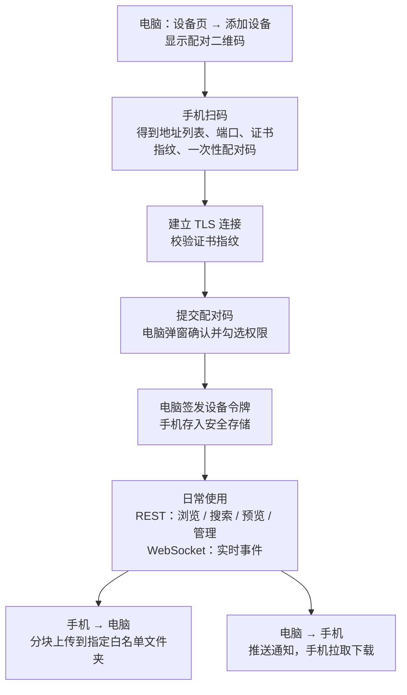
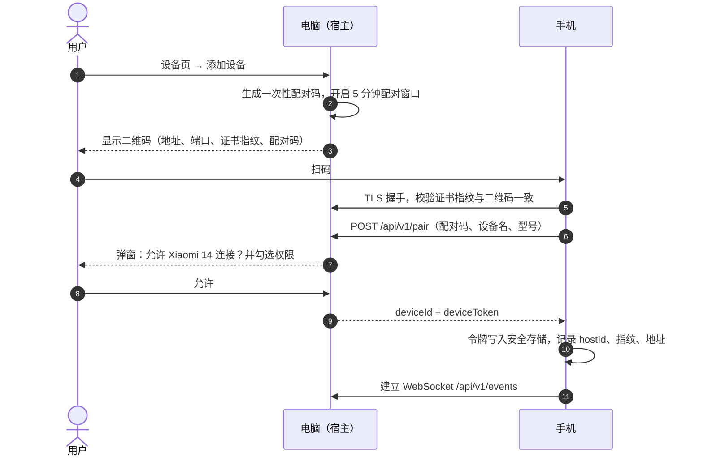
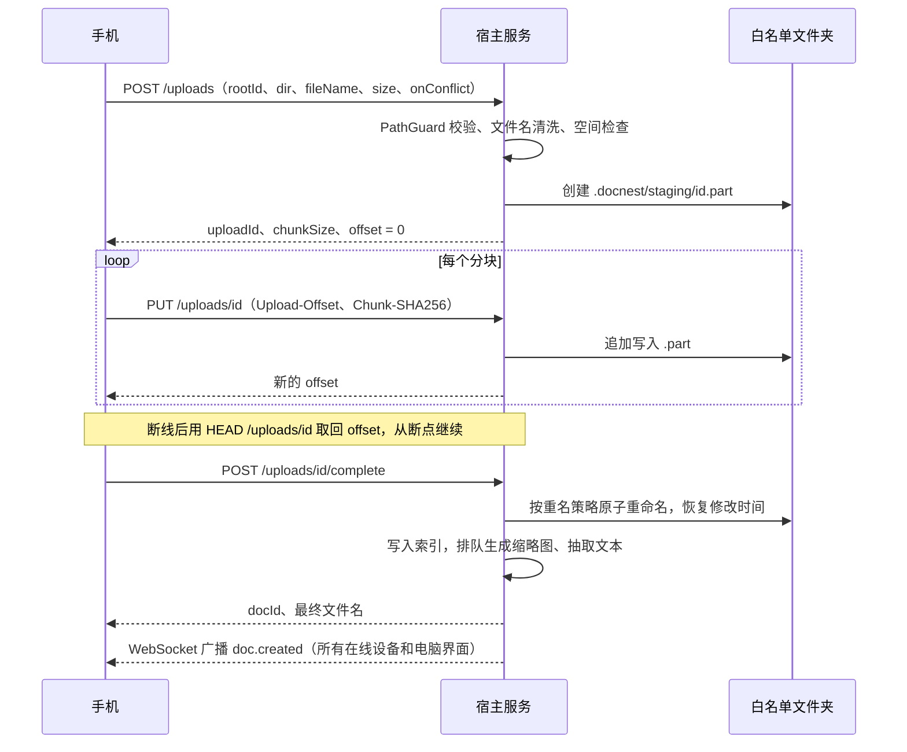
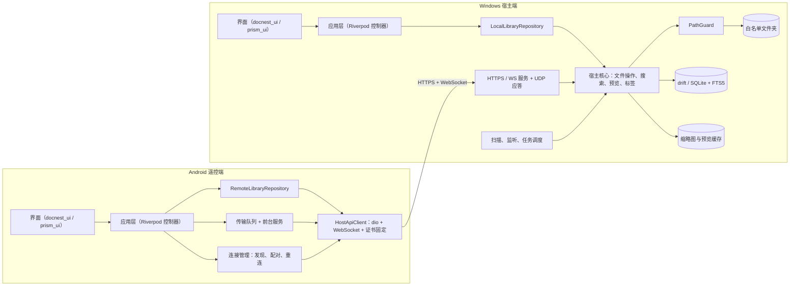
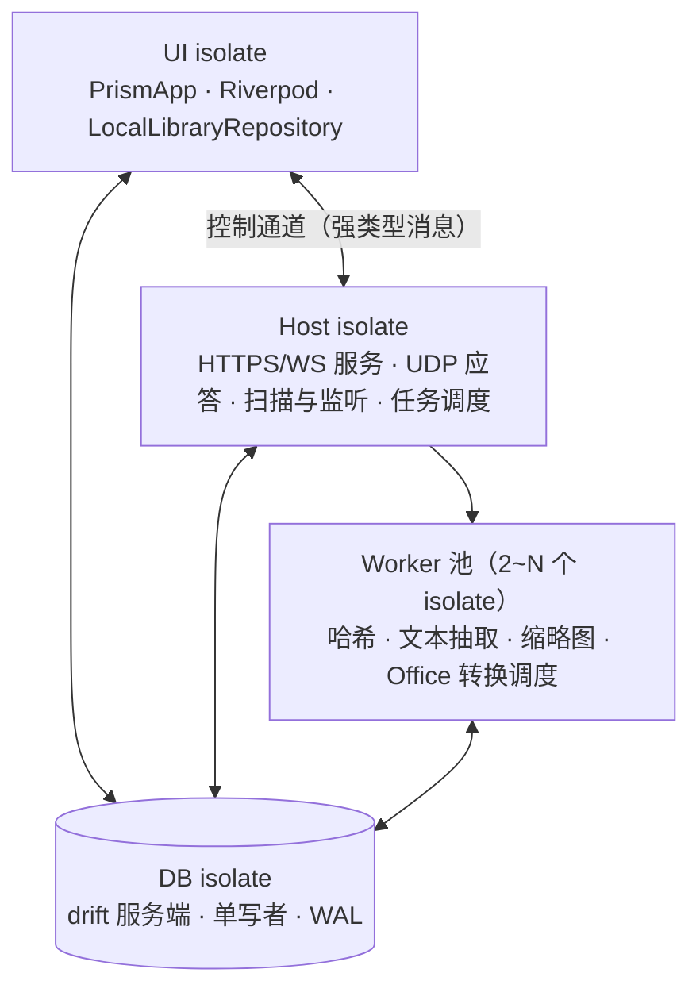
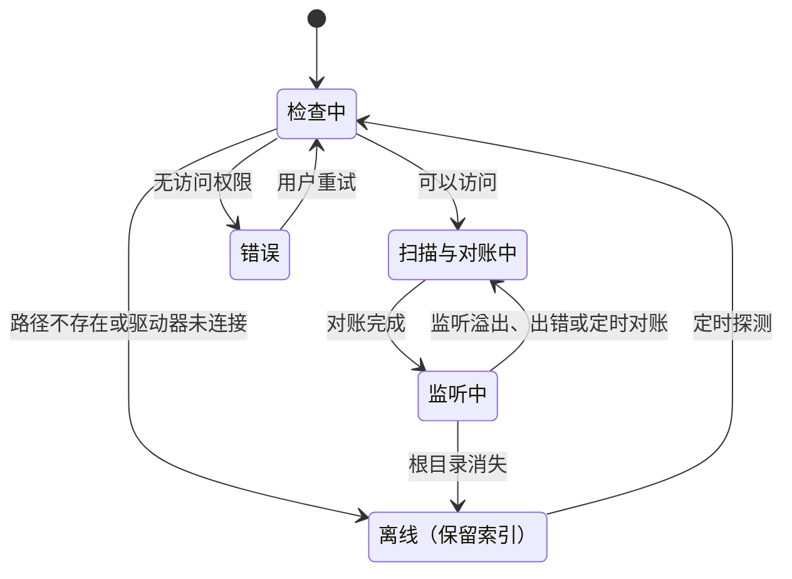
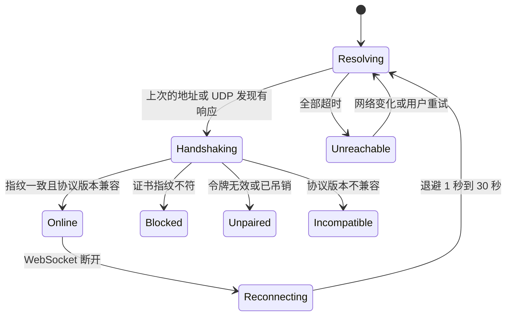

# DocNest 本地文档管理软件 · 开发计划

> 文档版本 v0.1 · 2026-11-07 · 暂定代号 DocNest（可替换）
> 平台：Windows 10/11（宿主端）+ Android 10+（遥控端）· Flutter 3.47.x · UI：prism_ui 0.1.2
> 阅读指引：第 3 节是局域网互传方案，第 4 节是软件架构，第 5 节是 UI 设计，第 6 节是开发规范，第 10 节是需要你拍板的问题。

**目录**

0. 摘要
1. 产品定位与范围
2. 功能规划
3. 局域网互传与远程管理
4. 软件架构
5. UI 设计
6. 开发规范
7. 里程碑与排期
8. 风险与对策
9. 非功能指标
10. 待决问题
附录 A–C

---

## 0. 摘要

DocNest 是一款本地优先、不依赖云的文档管理软件。

- **Windows 端是"宿主"**：只扫描用户加入白名单的文件夹，建立元数据、缩略图和全文索引，提供预览和文件操作，并在局域网内开放加密服务。
- **Android 端是"遥控端"**：与电脑配对后，浏览、搜索、预览、管理电脑上的资源库；在手机和电脑之间互传文件，手机上的文件可以直接投递到电脑上指定的白名单文件夹。

**局域网互传方案概要**

- 电脑内嵌 HTTPS（自签名证书）+ WebSocket 服务。
- 手机扫描电脑上的配对二维码。二维码带有证书指纹，手机据此做证书固定，防止中间人攻击；配对后用设备令牌访问。
- 上传采用分块断点续传：先写入目标根目录内的隐藏临时文件，校验后原子重命名落盘。
- 电脑发往手机的文件采用"电脑通知 + 手机拉取"，手机端不需要常驻服务。

**关键技术决策**

| 领域 | 决策 | 理由 |
|---|---|---|
| UI | prism_ui 0.1.2（精确锁版本），只允许 `docnest_ui` 包引用 | 指定的视觉风格；早期版本需要隔离 API 变动 |
| 应用根 / 路由 | `PrismApp` + Navigator 1.0（`CardPageRoute` / `FadePageRoute`）+ 自建类型化路由表 | `PrismApp` 封装的是 `WidgetsApp`，没有 Router API，无法直接接 go_router |
| 状态管理 / DI | Riverpod 3 + 代码生成 | 依赖注入、异步状态、按平台替换实现 |
| 数据层 | drift ≥ 2.32 + sqlite3 3.x，FTS5 + 中文二元切分 | 跨 isolate 共享、流式查询、全文检索 |
| 宿主服务 | shelf + `HttpServer.bindSecure`，运行在独立 isolate | 传输和哈希计算不卡界面 |
| 客户端 | dio + WebSocket，自定义 `HttpClient` 做证书指纹固定 | 自签证书 + 防中间人 |
| 设备发现 | 二维码（主）+ UDP 广播（重连）+ 手动 IP（兜底） | 不依赖 mDNS 在各种路由器上的兼容性 |
| 预览 | pdfrx（PDFium）统一两端；Office/WPS 在宿主端转成 PDF | Flutter 没有原生的 Office 渲染能力 |
| 工程 | Dart pub workspace 单仓多包 + melos 脚本 + FVM 锁定 Flutter 3.47.x | prism_ui 要求 Flutter ≥ 3.47 |

**需要你先拍板的两件事**（详见第 10 节）

1. **prism_ui 采用 GPL-3.0 许可。** Flutter 会把依赖编译进同一个应用，按通常的理解，分发应用时整个应用都要以 GPL-3.0 兼容的方式开源。自用或开源项目可以直接用；闭源或商用需要作者另行授权，或者只借鉴它的视觉风格、自建组件。本计划的 `docnest_ui` 隔离层就是为这条退路准备的。（以上不构成法律意见。）
2. **Office/WPS 文档预览依赖电脑上装有 Microsoft Office、WPS 或 LibreOffice 之一**，用于转成 PDF。三者都没有时，只能显示缩略图，或用外部程序打开。

---

## 1. 产品定位与范围

### 1.1 双端角色

| | Windows（宿主端） | Android（遥控端） |
|---|---|---|
| 定位 | 资源库唯一数据源，常驻托盘 | 遥控器 + 传输终端 |
| 本地数据 | 白名单文件夹、索引库、缩略图和预览缓存 | 配对信息、传输队列、浏览和预览缓存 |
| 核心能力 | 白名单管理、扫描索引、搜索、预览、文件操作、局域网服务、设备授权 | 浏览、搜索、预览、管理宿主资源库；手机 → 电脑投递；接收电脑发来的文件 |
| 网络角色 | 服务端（HTTPS/WS + UDP 发现应答） | 纯客户端（不开放任何端口） |

### 1.2 设计原则

1. **本地优先，零云依赖**：数据只在局域网内流动；不接入任何外网服务，统计和崩溃上报也不接（可以导出本地日志）。
2. **白名单最小权限**：只有白名单内的文件夹可见、可操作；本地界面和远程 API 走同一套路径校验（PathGuard）。
3. **不伤害用户文件**：不修改文件内容；删除一律先进回收站；所有写入都是"临时文件 + 原子重命名"；批量操作需确认，并且可撤销。
4. **索引可重建，用户数据不丢失**：缩略图和全文索引是派生数据，随时可以重建；标签、备注、收藏是用户数据，单独持久化，每天自动备份。
5. **一套代码，两种数据源**：浏览、搜索、预览等界面两端共享；Windows 端接本地实现，Android 端接远程实现。

### 1.3 v1 不做

- 云同步、多人协作、在线编辑文档（编辑交给系统默认程序）。
- iOS / macOS / Linux 客户端（宿主核心是纯 Dart，以后可以扩展）。
- 管理手机本地的文档库（手机只是上传源和下载目的地）。
- 公网访问。以后可以用 Tailscale / ZeroTier 这类虚拟局域网承载同一套协议（见 3.10）。

---

## 2. 功能规划

优先级：**P0** = MVP 必须；**P1** = 首个正式版；**P2** = 后续迭代。

### 2.1 Windows 宿主端

**A. 白名单管理**

- P0 添加、移除文件夹：用系统文件夹选择器，或把文件夹拖进窗口；可自定义显示名和颜色。
- P0 安全校验：拒绝系统目录（`C:\Windows`、`Program Files`、`AppData` 等）；把整个驱动器根目录加入时要二次确认；新目录与已有目录嵌套时提示合并。
- P0 每个根目录的规则：是否包含子文件夹、最大深度、文件类型（默认文档类型集合，见附录 B）、排除规则（glob）、是否包含隐藏和系统文件、是否跟随符号链接和联接点（默认不跟随）。
- P0 每个根目录的权限：本地只读、对手机可见、手机可修改、可作为上传目标。
- P1 根目录状态：在线 / 扫描中 / 离线 / 错误。U 盘拔出、网络盘断开时只标记为"离线"，**不删除索引**。
- P1 收件箱：指定一个白名单内的文件夹，作为手机"快速发送"的默认目的地。

**B. 扫描与索引**

- P0 首次全量扫描（后台 isolate，可暂停、可取消，显示进度）+ 文件系统事件增量更新 + 启动时对账扫描。
- P0 元数据：名称、扩展名、类型、大小、创建和修改时间、相对路径。
- P1 缩略图：优先用 Windows Shell 缩略图（与资源管理器一致），PDF 和图片自绘兜底。
- P1 全文索引：PDF、docx/xlsx/pptx、txt/md/csv 等；可按根目录开关；有单文件大小上限；笔记本使用电池时暂停。
- P1 文件身份追踪：基于 NTFS FileId，文件重命名或移动后，标签和备注仍然保留。
- P2 重复文件检测（大小 → 首尾快速哈希 → 全量哈希）；大文件和长期未打开文件分析。

**C. 浏览**

- P0 列表视图和网格视图；按名称、修改时间、大小、类型排序；按"根目录 → 文件夹"逐级浏览，带面包屑。
- P0 虚拟视图：全部文档、最近添加、最近打开、收藏、按类型。
- P1 筛选栏：类型、标签、时间范围、大小范围、根目录；筛选条件可以保存为"智能集合"。
- P1 右侧详情面板：预览、元数据、路径、标签、备注、常用操作。

**D. 搜索**

- P0 文件名搜索：子串匹配；支持拼音全拼和首字母（输入 `htgl` 能命中"合同管理"）；不区分全角/半角和大小写。
- P1 全文搜索：中文二元切分 + FTS5，结果显示高亮片段，文件名命中的结果排在前面。
- P1 筛选语法：`type:pdf tag:合同 ext:docx size:>10mb modified:2026-10`；保留搜索历史。

**E. 预览**

- P0 PDF（翻页、缩放、页面缩略图、文内搜索）、图片（缩放、旋转）、纯文本（自动识别 UTF-8/GBK）、Markdown。
- P1 Office/WPS：宿主端转成 PDF 后预览，转换结果缓存；按空格键快速查看（类似 macOS 的 Quick Look）。
- P2 xlsx 原生表格预览、音视频简单播放、查看压缩包目录。

**F. 文件操作**

- P0 用默认程序打开、在资源管理器中显示、重命名、删除（进回收站，可撤销）、复制路径。
- P1 在白名单内移动和复制、新建文件夹、从资源管理器拖入（复制到当前文件夹）、批量操作。
- P2 拖出到其他应用、"打开方式…"。

**G. 组织**

- P1 标签（任意颜色）、收藏、备注、最近打开记录。
- P2 智能集合；整理规则（例如把收件箱里的文件按类型或日期自动归档，执行前可预览结果）。

**H. 局域网服务与设备**

- P0 局域网服务开关、配对二维码、配对确认弹窗、已配对设备列表、吊销设备。
- P1 设备权限（浏览 / 上传 / 管理 / 删除）；远程操作审计日志；网络诊断（本机地址、端口、防火墙规则，网络类型为"公用"时提醒）。
- P2 网页投递：没装 App 的设备用浏览器上传。宿主内置 APK：手机扫码即可从电脑下载安装或升级。

**I. 传输中心**

- P0 接收中 / 已完成列表：进度、速度、目标路径、失败原因。
- P1 发送到手机（电脑 → 手机）、传输历史、在资源管理器中显示。

**J. 系统集成**

- P0 托盘常驻（关闭窗口 = 最小化到托盘，服务继续运行）、单实例。
- P1 开机自启；传输期间阻止系统睡眠；全局快捷键呼出搜索。
- P2 资源管理器右键菜单："添加到白名单" / "发送到手机"。

**K. 设置**

- P0 外观：浅色 / 深色 / 跟随系统；强调色（任意颜色、预设色、跟随系统强调色）；配色风格（鲜明 / 沉浸 / 柔和 / 单色，对应 prism_ui 的 `ColorStyle`）。
- P1 玻璃效果（关 / 标准 / 极致）、纯黑深色模式、字号缩放、降低动态效果、语言；索引设置；缓存管理；配置导入导出；导出日志和诊断包。

### 2.2 Android 遥控端

**A. 连接**

- P0 扫码配对；手动输入 `IP:端口` 配对（两端显示数字比对码，用户确认）；自动重连（先试上次的地址，再 UDP 发现）；显示连接状态。
- P1 多宿主：可以配对多台电脑，在顶部切换；连接诊断：逐项检查 Wi-Fi、局域网权限、宿主是否可达、证书、令牌。
- P2 网络唤醒（Wake-on-LAN）。

**B. 资源库**

- P0 浏览根目录和文件夹；虚拟视图（最近、收藏、类型）；列表 / 网格；排序。
- P0 搜索（在宿主端执行，结果分页返回）。
- P1 标签、筛选、智能集合、搜索历史。

**C. 预览**

- P0 PDF、图片、文本、Markdown（先下载到本地缓存再渲染）；缩略图网格。
- P1 Office/WPS（显示宿主转换好的 PDF）；预览缓存（LRU，容量可设）；"在电脑上打开"。
- P2 大 PDF 按需分段加载（HTTP Range）。

**D. 管理**

- P1 重命名、移动、新建文件夹、删除（进电脑的回收站）、打标签、收藏、备注、批量选择。

**E. 互传**

- P0 **手机 → 电脑**：在系统文件选择器里多选文件 → 选择目标白名单文件夹（收件箱 / 最近目的地 / 逐级浏览）→ 选择重名策略 → 上传。分块断点续传，通知栏显示进度。
- P0 **系统分享入口**：在微信、相册、文件管理等任意 App 里点"分享 → DocNest"，直接发到电脑。
- P1 **电脑 → 手机**：接收电脑推送的文件，保存到"下载/DocNest"；任意文档都可以"保存到手机"。
- P1 后台传输：前台服务 + 通知栏进度，可暂停、可取消；传输队列持久化，App 被杀后还能续传。
- P2 相册备份到指定文件夹（按日期归档）；剪贴板文本互传。

**F. 离线**

- P1 未连接时，可以浏览最近缓存的列表和已缓存的预览（只读），连上后自动刷新。

### 2.3 文档类型支持

| 类别 | 默认扩展名 | 缩略图 | 预览（两端） | 全文索引 |
|---|---|---|---|---|
| PDF | pdf | Shell 缩略图 / PDFium 渲染首页 | pdfrx | ✓ PDFium 抽取文本 |
| 文字 | doc, docx, wps, rtf, odt | Shell 缩略图 | 宿主转 PDF | docx/odt ✓（解析 XML）；doc/wps 列为 P2（IFilter） |
| 表格 | xls, xlsx, et, ods, csv | Shell 缩略图 | 宿主转 PDF；csv 直接显示为表格 | xlsx/csv ✓ |
| 演示 | ppt, pptx, dps, odp | Shell 缩略图 | 宿主转 PDF | pptx ✓ |
| 文本 | txt, md, log, json, xml, yaml, ini | 类型图标 | 原生渲染（自动识别编码） | ✓ |
| 电子书 | epub | P2 封面 | P2 | P2 |
| 图片（可选） | jpg, jpeg, png, webp, gif, bmp, heic | 缩放原图 / Shell 缩略图 | 原生渲染（HEIC 取决于平台解码能力） | — |
| 自定义 | 用户添加的扩展名 | 类型图标 | 外部程序打开 | — |

### 2.4 MVP 定义

MVP = 里程碑 M1–M3 中的 P0 项。验收场景：

1. 电脑添加 2 个白名单文件夹（其中一个约 5 万个文件）。扫描完成后，能按名称和拼音搜索，能预览 PDF、图片和文本。
2. 手机扫码配对后，能浏览、搜索、预览电脑上的文档。
3. 手机选 3 个文件（其中一个 1 GB）发到电脑的指定文件夹。传输中途关掉 Wi-Fi 再打开，能自动续传；文件出现在目标文件夹，电脑和手机上的列表都实时刷新。

---

## 3. 局域网互传与远程管理

### 3.1 方案选型

| 方案 | 优点 | 缺点 | 结论 |
|---|---|---|---|
| **电脑内嵌 HTTPS 服务，手机作客户端** | 手机不必常驻服务，避开 Android 后台限制；HTTP 天然支持 Range 和断点续传；互传和远程管理共用一套 API；方便调试 | 需要处理防火墙和自签证书 | **采用** |
| 手机也开服务（双向对等） | 电脑可以主动推送 | Android 后台保活难、耗电，还需要双向发现 | 不采用；电脑 → 手机改为"通知 + 手机拉取" |
| SMB 共享 / FTP | 现成可用 | 配置麻烦；套不上白名单规则和审计；安全性差 | 不采用 |
| 云中转 / WebRTC | 能跨网络 | 违背本地优先；实现复杂 | 不采用；跨网络需求交给虚拟局域网 |

### 3.2 总体流程



### 3.3 设备发现

1. **二维码（主路径，首次配对必用）**：在电脑上点"添加设备"后显示二维码，内容示例：

   ```text
   docnest://pair?v=1&h=<hostId>&n=HOME-PC&a=192.168.1.8,10.0.0.5&p=53420&f=<证书 SHA-256，base64url>&c=<一次性配对码>
   ```

   - 地址列表只放物理网卡（Wi-Fi、以太网）的私有地址，排除 WSL、Hyper-V、VMware、Docker 等虚拟网卡：用 `GetAdaptersAddresses` 按网卡类型和描述过滤。
   - 手机对列表里的所有地址**并发探测**，用最先连通的那个。
2. **UDP 发现（IP 变化后自动重连）**：
   - 手机向 `255.255.255.255`、子网定向广播地址和组播组（例如 `239.255.77.77`）的 53421 端口发送 `DISCOVER`，宿主单播回复 `{hostId, name, port}`。
   - 手机只连接已配对的 hostId，连接时照样校验证书指纹，所以伪造的应答没有危害。
   - 手机只发送、不接收组播，不需要申请 `MulticastLock`。
3. **手动输入**：输入 `IP:端口`。这种方式拿不到二维码里的指纹，所以采用"数字比对"：两端都显示一个由证书指纹派生的 6 位数，用户在电脑上确认一致后完成配对。
4. **地址缓存**：手机记住最近一次连通的地址，下次启动先直连，失败了再广播。
5. **mDNS（`_docnest._tcp`，可选 P2）**：作为补充手段，可以用 bonsoir 实现。
6. **Android 17 局域网权限**：
   - 应用 targetSdk ≥ 37 后，在 Android 17 设备上访问局域网（TCP 和 UDP）需要运行时权限 `ACCESS_LOCAL_NETWORK`，它属于"附近设备"权限组。
   - 未授权时，TCP 表现为连接超时，UDP 返回 `EPERM`。
   - 官方文档要求：targetSdk 低于 37 时不要在运行时申请这个权限。
   - 实现：targetSdk 升到 37 时，在首次配对前申请该权限，并在连接诊断里检测这一项。

### 3.4 配对与认证

- **宿主身份**：
  - 宿主首次启动时，生成 ECDSA P-256 密钥对和自签名 X.509 证书（有效期 10 年）。
  - `hostId` 是随机 UUID；证书指纹 = SHA-256(DER)。
  - 私钥存在 `flutter_secure_storage` 里，在 Windows 上由系统凭据存储保护。
- **配对窗口**：只在用户点"添加设备"后的 5 分钟内接受配对。配对码只能用一次，输错 5 次就关闭窗口。
- **确认与授权**：电脑弹窗确认"允许 Xiaomi 14 连接？"，同时勾选权限：浏览与预览、上传、管理（重命名、移动、新建文件夹、标签）、删除（进回收站）。默认全选，可以取消。
- **令牌**：配对成功后，宿主签发一个 256 位随机 `deviceToken`，自己只保存它的哈希；手机把令牌存进 `flutter_secure_storage`（由 Android Keystore 保护）。
- **日常请求**：TLS（证书指纹固定）+ `Authorization: Bearer <token>`；WebSocket 握手同样带令牌。
- **吊销**：在电脑的设备列表里一键吊销，立即断开该设备的 WebSocket，之后的请求都返回 401 `TOKEN_REVOKED`。
- **证书变化**：手机发现指纹不符时拒绝连接，提示"电脑的安全证书已变化，请重新配对"，**绝不自动信任新证书**。



### 3.5 上传：手机 → 电脑白名单文件夹

**流程**

1. 手机在"发送到电脑"面板里选择目标：收件箱、最近目的地，或者逐级浏览。可选的只有勾选了"可作为上传目标"的根目录。
2. `POST /api/v1/uploads` 创建上传会话，参数为 `{rootId, dir, fileName, size, modifiedAt, onConflict}`。宿主执行：
   - PathGuard 校验、文件名清洗、剩余空间检查；
   - 在**目标根目录内**的 `.docnest\staging\` 下创建 `<uploadId>.part`；
   - 返回 `{uploadId, chunkSize, offset}`。
3. `PUT /api/v1/uploads/{id}` 上传分块：
   - 请求头带 `Upload-Offset`，以及可选的 `Chunk-SHA256`；请求体是分块数据，默认 8 MiB，按实测速度在 1–16 MiB 之间调整。
   - 宿主校验偏移量和分块哈希后追加写入，返回新的偏移量。
4. **断点续传**：
   - 断线或 App 重启后，用 `HEAD /api/v1/uploads/{id}` 查询已接收的偏移量，从那里继续。
   - 上传会话持久化在宿主数据库里，宿主重启也不会丢。
   - 24 小时没有活动的会话自动过期，同时清理 `.part` 文件。
5. `POST /api/v1/uploads/{id}/complete` 完成上传，宿主依次执行：
   - 核对总大小（可选核对整体 SHA-256），按重名策略决定最终文件名；
   - 在**同一个卷内原子重命名**到目标位置，并恢复原始修改时间；
   - 立即写入索引，把缩略图生成和文本抽取排进任务队列；
   - 通过 WebSocket 广播 `doc.created`。
   - 文件监听随后也会收到同一个变化，对账时发现索引已是最新，直接忽略（对账是幂等的）。

**落盘规则**

- **重名策略**：`rename`（默认，生成"报告 (1).pdf"）/ `skip` / `overwrite`。覆盖时，旧文件先进回收站再替换，可以找回。
- **文件名清洗**：
  - 替换 Windows 非法字符 `<>:"/\|?*` 和控制字符；
  - 去掉末尾的点和空格；
  - `CON`、`PRN`、`AUX`、`NUL`、`COM1–9`、`LPT1–9` 这类保留名加前缀；
  - 单个文件名不超过 255 个 UTF-16 单元。
- **暂存目录放在目标根目录内**：与目标同卷，最后一步的重命名才是原子的。`.docnest` 目录带隐藏和系统属性，扫描时排除；只读根目录里不会创建它。
- **并发**：同时传 2 个文件；单个文件的分块按顺序发送，偏移量管理最简单。
- **文件夹上传（P2）**：手机用 SAF 选择目录树，按层级调用"新建文件夹"，再逐个上传文件。



### 3.6 下载与电脑 → 手机

- **下载**：`GET /api/v1/docs/{id}/content` 支持 `Range`、`ETag`、`If-Range`，下载可以断点续传；以后大 PDF 也能分段加载。
- **手机端存放位置**：
  - 预览文件放在 App 缓存目录，LRU 淘汰，默认上限 1 GB，可调。
  - "保存到手机"写入 `MediaStore.Downloads` 下的 DocNest 目录（Android 10+ 不需要存储权限），也可以用 SAF 让用户自选位置。
- **电脑 → 手机**：
  1. 在电脑上选中文件 → "发送到手机" → 选择设备。
  2. 宿主创建一条"待接收"记录，通过 WebSocket 推送 `transfer.offer`。
  3. 手机开启了"自动接收"时，收到后自动下载并发通知；否则在传输页的"来自电脑"里手动保存。
  4. 设备离线时，这条记录保留 24 小时，等手机下次连上再推送。整个过程手机不需要开放端口。

### 3.7 远程管理 API（v1）

**约定**

- 前缀 `/api/v1`；JSON 字段用 lowerCamelCase。
- 定位文件用 `rootId + 相对路径`（统一用 `/` 分隔）或 `docId`，**从不接受绝对路径**。
- 列表一律用游标分页：`?cursor=&limit=`。
- `/info` 返回 `indexEpoch`。宿主重建索引后 epoch 会变，手机据此清空与 docId 相关的缓存。

| 方法 | 路径 | 说明 | 所需权限 |
|---|---|---|---|
| GET | `/info` | 主机名、hostId、协议版本、能力列表、indexEpoch（不需要令牌，不含敏感信息） | — |
| POST | `/pair` | 配对（配对码或数字比对） | 配对窗口内 |
| GET | `/roots` | 对手机可见的根目录，含状态和统计 | browse |
| GET | `/roots/{rootId}/children?path=&sort=&cursor=` | 列出子文件夹和文档 | browse |
| GET | `/docs?q=&type=&tag=&root=&modified=&sort=&cursor=` | 搜索和筛选 | browse |
| GET | `/docs/{docId}` | 文档详情（元数据、标签、备注） | browse |
| GET | `/docs/{docId}/thumbnail?size=256` | 缩略图（支持 ETag） | browse |
| GET | `/docs/{docId}/preview` | 预览版本：PDF / 缩放后的图片 / UTF-8 文本；转换中返回 202 和 `Retry-After` | browse |
| GET | `/docs/{docId}/content` | 原文件（支持 Range） | browse |
| PATCH | `/docs/{docId}` | 重命名、收藏、备注 | manage |
| PUT | `/docs/{docId}/tags` | 设置标签 | manage |
| POST | `/docs/{docId}/open-on-host` | 在电脑上用默认程序打开（只允许文档类型） | manage |
| POST | `/ops/move`、`/ops/copy` | 批量移动、复制（只能在白名单内） | manage |
| POST | `/ops/trash` | 批量删除，返回用于撤销的 `trashToken` | delete |
| POST | `/ops/restore` | 在撤销时限内凭 `trashToken` 恢复 | delete |
| POST | `/folders` | 新建文件夹 | manage |
| GET / POST / PATCH / DELETE | `/tags`、`/tags/{tagId}` | 标签管理 | browse / manage |
| POST | `/uploads` | 创建上传会话 | upload |
| HEAD | `/uploads/{id}` | 查询已接收的偏移量 | upload |
| PUT | `/uploads/{id}` | 写入分块 | upload |
| POST | `/uploads/{id}/complete` | 完成上传并落盘 | upload |
| DELETE | `/uploads/{id}` | 取消上传 | upload |
| GET | `/offers` | 电脑推送给本设备、尚未接收的文件 | browse |
| WS | `/events` | 实时事件 | browse |

**错误格式**（HTTP 状态码 + 统一结构）：

```json
{ "error": { "code": "PATH_OUTSIDE_ROOT", "message": "目标路径不在白名单内", "details": { "rootId": 3 } } }
```

错误码定义在 `docnest_protocol` 包里，与客户端的异常类型一一对应：`UNAUTHORIZED`、`TOKEN_REVOKED`、`FORBIDDEN_SCOPE`、`ROOT_NOT_FOUND`、`ROOT_OFFLINE`、`ROOT_READ_ONLY`、`PATH_OUTSIDE_ROOT`、`INVALID_NAME`、`NAME_CONFLICT`、`NOT_FOUND`、`FILE_LOCKED`（被其他程序占用）、`INSUFFICIENT_SPACE`、`UPLOAD_OFFSET_MISMATCH`、`UPLOAD_EXPIRED`、`CHECKSUM_MISMATCH`、`PREVIEW_UNAVAILABLE`、`RATE_LIMITED`、`PROTOCOL_UNSUPPORTED`。

### 3.8 实时事件（WebSocket）

- **事件类型**：`doc.created`、`doc.updated`、`doc.moved`、`doc.deleted`、`folder.changed`、`root.status`、`scan.progress`、`preview.ready`、`transfer.offer`、`device.revoked`、`host.shutdown`。
- **轻量载荷**：事件只带 id 和少量字段，客户端按需重新拉取。
- **补发**：每条事件带递增序号。重连时带上最后收到的序号，宿主从缓冲区（例如最近 1000 条）补发；超出缓冲区就通知客户端整体刷新。

### 3.9 安全清单

1. **传输**：TLS 1.2+，证书指纹固定；不接受明文 HTTP（网页投递模式除外，需要单独开启）。
2. **认证**：每台设备一个令牌，宿主只存哈希，可以吊销；配对失败和认证失败都限流。
3. **授权**：设备权限（browse / upload / manage / delete）和根目录开关（对手机可见 / 手机可修改 / 可作为上传目标）两者都满足才放行。
4. **PathGuard**：所有本地和远程文件操作的唯一入口。
   - 输入只能是 `(rootId, 相对路径)`。
   - 拒绝 `..`、驱动器号、UNC 路径（`\\server\share`）、`\\?\` 前缀、备用数据流（`a.txt:stream`）、保留设备名、末尾的点和空格。
   - 规范化之后，确认最终路径仍在根目录内（Windows 下不区分大小写）。
   - 路径链上有联接点或符号链接时拒绝，除非该根目录明确允许。
   - 打开句柄后用 `GetFinalPathNameByHandleW` 复核真实路径，防止"检查之后被替换"（TOCTOU）。
5. **服务暴露面**：
   - 只在用户开启时监听。
   - 来源地址不在私有网段（RFC 1918、链路本地、IPv6 ULA）时直接断开；可选放行 Tailscale 的 `100.64.0.0/10`。
   - 限制请求体大小、超时时间和并发连接数。
6. **远程打开**：`open-on-host` 只允许文档类扩展名，永远拒绝 `.exe .bat .cmd .ps1 .vbs .js .msi .lnk .url .scr` 等可执行文件和快捷方式。
7. **Office 转换**：以只读方式打开临时副本并禁用宏（Office COM 设置 `AutomationSecurity = msoAutomationSecurityForceDisable`）；转换进程设超时，超时直接结束进程。
8. **审计**：每次远程写操作都记录时间、设备、操作、对象、结果，可以在电脑上查看和导出。
9. **可选加固（P2）**：给来自手机的文件写入 `Zone.Identifier` 网络标记，让 Office 用受保护视图打开它们。

### 3.10 网络兼容与诊断

| 场景 | 现象 | 对策 |
|---|---|---|
| Windows 防火墙拦截 | 手机连接超时 | 安装器写入入站规则（只对"专用"网络）；首次运行时引导；手机诊断页给出提示 |
| 网络类型为"公用" | 防火墙默认更严格 | 用 `INetworkListManager` 检测并提醒，一键打开系统网络设置 |
| 路由器开启 AP 隔离（访客网络、校园网、公司网常见） | 两端互相访问不到 | 诊断给出结论，建议切换到**直连模式**：电脑开"移动热点"让手机连上，或者电脑连手机热点 |
| 多网卡、VPN、WSL / Hyper-V 虚拟网卡 | 二维码里出现错误的地址 | 二维码只放物理网卡地址；手机并发探测所有地址 |
| 电脑 IP 变化（DHCP） | 上次的地址失效 | UDP 发现；或者重新扫码 |
| 电脑睡眠 | 无法连接 | 传输期间阻止睡眠；P2 支持网络唤醒 |
| 不在同一个局域网 | 无法连接 | v1 不支持；以后用 Tailscale / ZeroTier 组网，协议不变 |

### 3.11 Android 端实现要点

- **选文件**：用系统选择器（SAF `ACTION_OPEN_DOCUMENT`，多选），不需要存储权限。文件加入队列时调用 `takePersistableUriPermission`，否则 App 重启后 `content://` URI 失效，无法续传。
- **读大文件**：自建一个小的平台通道，用 `ContentResolver.openFileDescriptor` + `FileChannel.position()` 按偏移量读取分块。这样不用先把大文件复制到缓存目录，续传时也能直接定位。
- **分享入口**：注册 `ACTION_SEND` / `ACTION_SEND_MULTIPLE` 的 intent-filter（`*/*`），用 `share_handler`（或 `receive_sharing_intent`）接收，直接打开"发送到电脑"面板。
- **后台传输**：
  - 队列不空时启动前台服务（`foregroundServiceType="dataSync"`），通知栏显示进度，并持有 Wi-Fi 锁和部分唤醒锁；队列清空就停止。
  - 需要的权限：Android 13+ 的 `POST_NOTIFICATIONS`，Android 14+ 的 `FOREGROUND_SERVICE_DATA_SYNC`。
  - 从 Android 15 起，dataSync 类型的前台服务每 24 小时最多运行 6 小时；超时回调里要暂停队列并提示用户。
  - 也可以评估 Android 14 引入的"用户发起的数据传输作业"（user-initiated data transfer job）。
- **国产 ROM**：HyperOS、ColorOS 等后台管控严格。帮助页引导用户允许后台运行、关闭电池优化。即使进程被杀，持久化的队列也能在下次打开时续传。
- **网络切换**：监听网络变化。Wi-Fi 断开时暂停；连回同一网络、确认宿主可达后自动继续。

---

## 4. 软件架构

### 4.1 总体架构



### 4.2 分层与依赖规则

```text
presentation   页面、组件、交互（只使用 docnest_ui）
     |
application    控制器 / 用例（Riverpod Notifier），编排领域服务
     |
domain         实体、值对象、仓库接口、领域服务（纯 Dart，不依赖 Flutter）
     ^ 实现
data / infra   drift、文件系统、HTTP 服务端与客户端、平台通道、Win32 FFI
```

- 依赖只能自上而下；domain 不 import Flutter，也不 import 任何具体实现。
- 平台实现只在组合根（`bootstrapHost()` / `bootstrapRemote()`）里选择，业务代码里不出现 `Platform.isWindows` 这类分支。
- 两端共享界面的关键是仓库接口：

```dart
abstract interface class LibraryRepository {
  Stream<List<Root>> watchRoots();
  Future<PageOf<DocEntry>> query(DocQuery query, {String? cursor});
  Future<DocDetail> detail(DocId id);
  Future<void> rename(DocId id, String newName);
  Future<TrashTicket> trash(List<DocId> ids);
  Future<void> restore(TrashTicket ticket);
  Stream<LibraryEvent> events();
}

// Windows：LocalLibraryRepository  → drift + FileOpsService（同进程直接调用）
// Android：RemoteLibraryRepository → HostApiClient（HTTPS + WebSocket）
```

### 4.3 仓库结构

```text
docnest/
├─ pubspec.yaml                  # pub workspace 根（workspace: 列出各包）
├─ melos.yaml  .fvmrc            # 常用脚本；锁定 Flutter 版本
├─ apps/
│  └─ docnest/                   # Flutter 应用（windows + android 两个平台工程）
│     ├─ lib/
│     │  ├─ main.dart            # 按平台调用 bootstrapHost() / bootstrapRemote()
│     │  ├─ app/                 # PrismApp 根、主题、路由表、DI 组合根、外壳布局
│     │  ├─ features/
│     │  │  ├─ library/          # 浏览（两端共享）
│     │  │  ├─ search/           # 搜索（两端共享）
│     │  │  ├─ preview/          # 预览（两端共享，数据源不同）
│     │  │  ├─ organize/         # 标签、收藏、备注、智能集合
│     │  │  ├─ transfer/         # 传输中心（两端各有页面）
│     │  │  ├─ sources/          # 白名单管理（仅 Windows）
│     │  │  ├─ devices/          # Windows：二维码与设备管理；Android：宿主列表与配对
│     │  │  └─ settings/
│     │  └─ l10n/                # ARB 文案 + UiLocalizations 中英实现
│     ├─ windows/  android/      # 平台工程（Android 原生：SAF 分块读取、前台服务）
│     └─ integration_test/
├─ packages/
│  ├─ docnest_core/              # 纯 Dart：实体、值对象、仓库接口、错误类型、工具
│  ├─ docnest_protocol/          # 纯 Dart：API DTO、路由常量、错误码、协议版本（两端共享）
│  ├─ docnest_host/              # 扫描、监听、索引、搜索、文件操作、PathGuard、HTTPS 服务
│  ├─ docnest_remote/            # HostApiClient、证书固定、发现、配对、传输队列
│  ├─ docnest_win32/             # Windows FFI：回收站、Shell 缩略图、FileId、电源请求、网卡枚举
│  └─ docnest_ui/                # 基于 prism_ui 的组件库：tokens、组件、图标、Material 桥接
├─ tools/                        # 生成测试目录树、检查 import 规则、打包脚本
└─ docs/                         # ADR、协议文档（OpenAPI）、设计稿、AGENTS.md
```

`docnest_host` 尽量保持纯 Dart，可以直接用 `dart test` 测试；依赖 Flutter 插件的能力（如 pdfrx 渲染缩略图）通过接口注入。

### 4.4 Windows 端运行时模型（isolate 分工）



- **数据库是协调中心**：所有 isolate 连接同一个 drift 后台 isolate，表变更通知会广播给每个连接。例如手机上传了一个文件，Host isolate 写入数据库后，桌面界面上的流式查询会自动刷新。
- **控制通道**：UI ↔ Host isolate 之间传递强类型消息，例如启停服务、开关配对窗口、重新扫描、上传进度。配对请求的流程是：Host 收到请求 → 通知 UI 弹窗 → 用户选择 → UI 回传决定 → Host 再响应 HTTP 请求（最多挂起 60 秒）。
- **文件操作是无状态服务**（PathGuard + 文件系统 + 数据库），两个 isolate 都能调用。对账是幂等的，所以本地操作和监听事件不会互相冲突。
- **重计算交给 worker 池**；Office 转换在子进程里执行（PowerShell 或 LibreOffice），由 worker 负责超时控制。
- **插件与 COM 的注意事项**：
  - 后台 isolate 调用 Flutter 插件前需要 `BackgroundIsolateBinaryMessenger.ensureInitialized`；纯 FFI（win32、PDFium）可以直接用。
  - COM 调用要在同一段同步代码里完成 `CoInitializeEx` → 调用 → `CoUninitialize`，因为 Dart isolate 在 `await` 前后可能运行在不同的系统线程上。

### 4.5 核心模块设计

#### 4.5.1 白名单与 PathGuard

```dart
/// 所有本地和远程文件操作的唯一入口：输入永远是 (rootId, 相对路径)，不接受绝对路径。
ResolvedPath resolve(Root root, String relPath) {
  final segments = relPath.split(RegExp(r'[\\/]+')).where((s) => s.isNotEmpty).toList();
  for (final s in segments) {
    if (s == '.' || s == '..' || s.contains(':') || _reservedName.hasMatch(s) ||
        s.endsWith('.') || s.endsWith(' ') || _illegalChars.hasMatch(s)) {
      throw const AppException.invalidPath();
    }
  }
  final full = p.windows.normalize(p.windows.joinAll([root.path, ...segments]));
  if (!p.windows.isWithin(root.path, full) && !p.windows.equals(root.path, full)) {
    throw const AppException.pathOutsideRoot(); // Windows 下按不区分大小写比较
  }
  // 还要检查：路径链上没有联接点/符号链接（除非根目录允许）；
  // 打开句柄后用 GetFinalPathNameByHandleW 复核真实路径仍在根目录内（防 TOCTOU）。
  return ResolvedPath(root: root, relPath: segments.join('/'), fullPath: full);
}
```

#### 4.5.2 扫描、监听与对账



1. **枚举**：Windows 下用 `FindFirstFileExW`（`FindExInfoBasic` + `FIND_FIRST_EX_LARGE_FETCH`），一次拿到名称、大小、修改时间、属性，不必对每个文件再调一次 stat。按目录广度优先遍历，每 500 条一批交给数据库比对。
2. **比对**：
   - 路径相同但大小或修改时间变了 → 更新记录，重新排队生成缩略图、抽取文本。
   - 新路径 → 读取 FileId。如果命中一条"缺失"状态的旧记录，就当作移动处理：更新路径，保留标签和备注。
   - 没有变化 → 跳过。
3. **收尾**：完整遍历成功后，本轮没见到的记录标记为"缺失"，保留 7 天用于识别移动，过期后删除。**遍历中途失败（比如 U 盘被拔掉）时不做标记。**
4. **监听**：
   - 每个根目录一个 `Directory.watch(recursive: true)`，Windows 底层是 `ReadDirectoryChangesW`。
   - 事件去抖 1 秒后按路径对账；目录事件对该子树对账。
   - 监听报错或缓冲区溢出时，安排一次整根对账。网络盘默认改为定时轮询。
5. **稳定性检查**：正在复制的大文件，要等大小和修改时间稳定几秒后再哈希、抽取；被 Office 独占的文件（共享冲突）按退避策略稍后重试。
6. **云盘占位文件**：OneDrive 等"按需下载"的文件带 `RECALL_ON_DATA_ACCESS` 或 `OFFLINE` 属性。这类文件只索引元数据，**不读取内容**，因为读内容会触发下载；用户可以在该根目录开启"包含云端文件"。
7. **默认排除**：Office 锁文件 `~$*`、`*.tmp`、`Thumbs.db`、`.git`、`node_modules`、`.docnest` 等，完整列表见附录 B。

#### 4.5.3 后台任务流水线

- **持久化**：任务表存在数据库里：`jobs(kind, docId, priority, attempts, nextRunAt, lastError)`，kind 包括 thumbnail / text / quickHash / convert。宿主重启后接着执行。
- **优先级**：界面上可见的缩略图 > 用户正在打开的预览转换 > 新文件的文本抽取 > 全库补齐。
- **并发与重试**：
  - worker 数 = min(2, CPU 核数 / 2)；Office 转换同一时间只跑 1 个。
  - 笔记本使用电池时暂停文本抽取。
  - 失败按指数退避重试，最多 5 次，之后标记为"失败"，并在界面上显示原因。

#### 4.5.4 搜索

- **文件名**：
  - 存三个字段：`nameNorm`（NFKC + 小写 + 全角转半角）、`namePinyin`、`nameInitials`。拼音由 lpinyin 生成，多音字取常用读音。
  - 查询时三者任一包含查询词即命中。
  - 10 万条以内用 `LIKE` 扫描就足够快；库再大时，文件名也放进 FTS。
- **全文**：
  - 抽取出的文本先做"中文二元切分"，再写入 FTS5（`unicode61` 分词器）。连续的中日韩字符切成重叠的两字词，例如"合同管理" → "合同 同管 管理"；拉丁字母和数字按词处理。
  - 查询词做同样的切分，再用短语查询；单字查询改用前缀匹配。
  - 这样两字词也能命中。FTS5 自带的 `trigram` 分词器要求查询至少 3 个字符，不适合中文里最常见的两字词。
- **排序**：bm25 + 文件名命中加权 + 最近打开加权。索引里存的是切分后的文本，所以高亮片段由 Dart 在原文上计算。
- **语法**：`type:`、`tag:`、`ext:`、`size:`、`modified:`、`root:` 解析成结构化筛选，再与关键词组合；界面上的筛选 Chip 同步显示。
- **抽取上限**：单个文件最多抽取 2 MB 文本；docx/xlsx/pptx 超过 50 MB 跳过；加密 PDF 跳过。

#### 4.5.5 预览与格式转换

- **渲染方式**：
  - PDF、图片、文本、Markdown 原生渲染。
  - Office/WPS 先转成 PDF。
  - 其他格式只显示文件信息和"用外部程序打开"。
- **转换器链**（启动时探测，按顺序尝试）：
  1. Microsoft Office COM：Word / Excel / PowerPoint 的 `ExportAsFixedFormat`。
  2. WPS COM：WPS 提供与 Office 类似的自动化接口，ProgID 和导出参数需要实测。
  3. LibreOffice headless：`soffice --headless --convert-to pdf`，每个并发进程使用独立的 `-env:UserInstallation` 配置目录。
  4. 以上都没有：只用 Shell 缩略图。
- **缓存**：预览存为 `<缓存目录>/previews/<docId>-<size>-<mtime>.pdf`，缩略图同理；LRU 淘汰，默认上限 2 GB。
- **文本**：编码检测顺序为 BOM → 合法 UTF-8 → 回退到 GB18030/GBK。大文本按窗口分段读取，用虚拟化列表显示。
- **手机端**：调用同一个 `/preview` 接口，宿主返回已经转换好的 PDF、缩放后的图片或 UTF-8 文本，所以手机只需要 PDF、图片、文本三种渲染器。

#### 4.5.6 文件操作

- **统一入口**：所有操作都经过 `FileOpsService`：PathGuard → 权限检查 → 执行 → 更新数据库 → 写审计日志 → 发事件。
- **两段式删除**：
  1. 先把文件移到同一根目录下的 `.docnest\trash\`（同卷移动，瞬间完成），界面显示"已删除 · 撤销"横幅 8 秒。
  2. 超时后，用 `IFileOperation`（`FOFX_RECYCLEONDELETE`）把文件送进系统回收站。
  - 撤销就是把文件移回原处，不需要去回收站里找。
  - 应用启动时，把上次遗留的待删文件送进回收站。
- **跨卷移动** = 复制 → 校验大小（可选校验哈希）→ 删除源文件，与资源管理器的行为一致。
- **防误操作**：一次操作超过 50 个文件要二次确认；只读根目录拒绝任何写操作。

#### 4.5.7 宿主服务

- **请求处理管线**：`HttpServer.bindSecure(InternetAddress.anyIPv4, port, securityContext)` + shelf 中间件，依次为：访问日志 → 来源地址过滤 → 限流 → 认证 → 权限 → 路由 → 统一错误映射。
- **端口**：默认 TCP 53420、UDP 53421；被占用时自动换端口，二维码和发现应答里带实际端口。
- **流式传输**：上传和下载都流式处理，不把整个文件读进内存；单个请求体上限 = 分块大小 + 1 MiB。

#### 4.5.8 远程客户端（Android）



- **`HostApiClient`**：dio + 证书固定（代码见下）；所有请求自动带令牌；收到 401 时进入 Unpaired 状态。
- **`TransferQueue`**：
  - 任务持久化在本地的 drift 表里。
  - 状态流转：queued → running → paused → done / failed。
  - 同时执行 2 个任务；失败按指数退避重试；完成后发系统通知。
- **缓存**：缩略图用 `flutter_cache_manager`，替换它的 HTTP 实现，让请求走证书固定的客户端；预览文件按 `docId + ETag` 缓存。

```dart
HttpClient pinnedHttpClient(String expectedFingerprint) {
  final client = HttpClient(context: SecurityContext(withTrustedRoots: false));
  // 自签证书必然校验失败并进入这个回调：只放行指纹与配对时记录的一致的证书。
  client.badCertificateCallback = (cert, host, port) =>
      base64Url.encode(sha256.convert(cert.der).bytes) == expectedFingerprint;
  return client;
}

final dio = Dio(BaseOptions(baseUrl: 'https://$address:$port/api/v1'))
  ..httpClientAdapter = IOHttpClientAdapter(createHttpClient: () => pinnedHttpClient(fp));

final ws = await WebSocket.connect(
  'wss://$address:$port/api/v1/events',
  headers: {'Authorization': 'Bearer $token'},
  customClient: pinnedHttpClient(fp),
);
```

### 4.6 数据模型

**宿主端（drift）**

| 表 | 关键字段 | 说明 |
|---|---|---|
| `roots` | id, path, name, color, recursive, maxDepth, includeExts, excludeGlobs, includeHidden, followLinks, localReadOnly, remoteVisible, remoteWritable, uploadTarget, contentIndex, status, lastScanAt | 白名单根目录及其规则 |
| `folders` | id, rootId, relPath, parentId, name | 文件夹树（含空文件夹）；唯一键 (rootId, relPath) |
| `documents` | id, rootId, folderId, relPath, name, nameNorm, namePinyin, nameInitials, ext, kind, size, createdAt, modifiedAt, fileId, quickHash, attrs, state, missingSince, thumbState, textState, pageCount | 唯一键 (rootId, relPath)；索引 kind、modifiedAt、fileId、state |
| `doc_fts` | nameTokens, contentTokens | FTS5 虚表，rowid = documents.id |
| `doc_meta` | docId, favorite, note, lastOpenedAt, openCount | 用户数据，与派生数据分开存放 |
| `tags` / `doc_tags` | id, name, color, sortOrder / docId, tagId | 标签 |
| `collections` | id, name, queryJson, sortOrder | 智能集合 |
| `devices` | id, name, platform, model, tokenHash, scopes, pairedAt, lastSeenAt, lastIp, revokedAt | 已配对设备 |
| `upload_sessions` | id, deviceId, rootId, dir, fileName, size, offset, onConflict, modifiedAt, stagingPath, state, expiresAt | 上传会话（宿主重启后仍可续传） |
| `offers` | id, deviceId, docId, state, createdAt, expiresAt | 电脑推给手机、待接收的文件 |
| `jobs` | id, kind, docId, priority, attempts, nextRunAt, lastError | 后台任务 |
| `audit_log` | id, at, actor, action, target, result, detail | 审计日志 |
| `settings` | key, value | 配置（JSON） |

```dart
class Documents extends Table {
  IntColumn get id => integer().autoIncrement()();
  IntColumn get rootId => integer().references(Roots, #id)();
  TextColumn get relPath => text()();            // 相对根目录，统一用 '/' 分隔
  TextColumn get name => text()();
  TextColumn get nameNorm => text()();           // NFKC + 小写 + 全角转半角
  TextColumn get namePinyin => text()();         // hetongguanli
  TextColumn get nameInitials => text()();       // htgl
  TextColumn get ext => text()();
  IntColumn get kind => intEnum<DocKind>()();
  IntColumn get size => integer()();
  DateTimeColumn get modifiedAt => dateTime()();
  TextColumn get fileId => text().nullable()();  // 卷序列号 + NTFS FileId
  IntColumn get state => intEnum<DocState>()();  // active / missing

  @override
  List<Set<Column>> get uniqueKeys => [{rootId, relPath}];
}
```

- **用户数据备份**：
  - 每天把 `doc_meta`、`doc_tags`、`tags`、`collections`、`roots` 导出为 JSON，保留 7 份。
  - 每条记录带上 rootPath + relPath + fileId + size + modifiedAt 作为身份信息；重建索引后按身份重新挂回。
- **数据库**：启用 WAL 模式；表结构变更用 drift 的 schema 版本管理，并配迁移测试。

**手机端（drift）**

- `hosts`：hostId、name、certFingerprint、lastAddresses、port、pairedAt、lastConnectedAt。令牌不入库，按 hostId 存在安全存储里。
- `transfer_tasks`：id、hostId、direction、sourceUri、fileName、size、targetRootId、targetDir、onConflict、uploadId、offset、state、error、createdAt。
- `recent_destinations`、`recent_searches`。
- `page_cache`：短期列表缓存，用于离线浏览。

### 4.7 状态管理与依赖注入（Riverpod 3）

```dart
Future<void> main() async {
  WidgetsFlutterBinding.ensureInitialized();
  // 全项目唯一一处平台分支：组合根按平台装配仓库实现
  final overrides = Platform.isWindows ? await bootstrapHost() : await bootstrapRemote();
  runApp(ProviderScope(overrides: overrides, child: const DocNestApp()));
}
// bootstrapHost()：libraryRepositoryProvider → LocalLibraryRepository（drift + 文件操作）
// bootstrapRemote()：libraryRepositoryProvider → RemoteLibraryRepository（当前宿主的 HostApiClient）
```

- **基础设施 provider**（keepAlive）：database、hostApiClient、connectionManager、libraryRepository。
- **控制器**（默认 autoDispose）：`LibraryListController`（分页、排序、筛选）、`SearchController`、`PreviewController`、`TransferQueueController`。
- **参数化 provider**：`docDetailProvider(docId)`、`rootChildrenProvider(rootId, path)`。
- **局部刷新**：列表控制器订阅仓库的事件流，收到相关事件时只刷新受影响的部分，不整页重载。

### 4.8 技术选型

> 具体版本在 M0 阶段以 pub.dev 上与 Flutter 3.47 兼容的最新版为准，并记录到 ADR。

| 用途 | 选型 | 说明 |
|---|---|---|
| SDK | Flutter 3.47.x（FVM 锁定） | prism_ui 要求 Flutter ≥ 3.47、Dart ≥ 3.10；3.47 起 Windows 默认使用 Impeller 渲染 |
| UI | prism_ui 0.1.2 | 精确锁版本，只在 `docnest_ui` 内引用 |
| 状态管理 / DI | flutter_riverpod 3 + riverpod_generator | |
| 模型 / JSON | freezed + json_serializable | freezed_annotation 主版本与 prism_ui 一致（3.x） |
| 数据库 | drift ≥ 2.32 + sqlite3 3.x | 通过 build hooks 自动打包 SQLite，不再需要 sqlite3_flutter_libs；FTS5 是否启用待 M0 验证 |
| 拼音 | lpinyin | |
| 服务端 | shelf、shelf_router、shelf_web_socket | 基于 `dart:io` 的 `HttpServer.bindSecure` |
| 客户端 | dio、web_socket_channel | 自定义 `HttpClient` 做证书固定 |
| 证书与加密 | basic_utils / pointycastle、crypto | 生成 P-256 自签证书；计算 SHA-256 |
| 安全存储 | flutter_secure_storage | 令牌、私钥 |
| PDF | pdfrx | 基于 PDFium，两端一致，支持文本抽取 |
| Office XML 解析 | archive、xml | docx/xlsx/pptx 文本抽取 |
| 文本编码 | 自研检测 + pub.dev 上的 GBK 编解码包（M0 选定） | |
| Markdown | markdown（解析）+ markdown_widget（经 Material 桥接）或自研渲染 | flutter_markdown 已停止维护 |
| 图片查看 | Flutter 自带的 `InteractiveViewer` | 不引入 Material 依赖 |
| 二维码 | qr（生成矩阵后自绘）、mobile_scanner（扫码） | |
| 窗口 / 托盘 / 自启 | window_manager、tray_manager、launch_at_startup | |
| 拖放 | desktop_drop（拖入）；super_drag_and_drop（P2 拖出） | |
| Win32 能力 | win32 + ffi，封装在 `docnest_win32` | 回收站、Shell 缩略图、FileId、电源请求、网卡枚举 |
| 系统强调色 | dynamic_color 或 system_theme | 取到的颜色作为 seed 传给 prism（prism 本身没有原生代码） |
| Android 文件 | file_picker（SAF）+ 自建分块读取通道 | |
| 分享入口 | share_handler（或 receive_sharing_intent） | |
| 前台服务 | flutter_foreground_task | dataSync 类型；Wi-Fi 锁、唤醒锁 |
| 网络 | connectivity_plus、network_info_plus | |
| 缓存 | flutter_cache_manager | 替换 HTTP 实现，走证书固定 |
| 本地化 | flutter_localizations + gen-l10n、intl | |
| 日志 | logging + 自研滚动文件输出 | |
| 测试 | test、flutter_test、integration_test、mocktail | |

Flutter 正在把 Material 和 Cupertino 拆成独立包：3.47 发布了 `material_ui` / `cupertino_ui` 1.0，官方计划在 11 月的 stable 版本中正式弃用 SDK 内置的版本。本项目的界面不依赖 Material，受影响的只有第三方组件，升级 Flutter 时留意它们的迁移情况即可。

### 4.9 平台能力清单

| 能力 | Windows 宿主 | Android 遥控端 |
|---|---|---|
| 删除到回收站 | `IFileOperation`（`FOFX_RECYCLEONDELETE`） | 调用宿主接口 |
| 缩略图 | `IShellItemImageFactory::GetImage` | 调用宿主接口 |
| 文件身份 | `GetFileInformationByHandleEx(FileIdInfo)` + 卷序列号 | — |
| 快速枚举 | `FindFirstFileExW`（`FIND_FIRST_EX_LARGE_FETCH`） | — |
| 打开 / 定位 | `ShellExecuteExW` / `SHOpenFolderAndSelectItems` | 用 Intent 交给其他应用打开 |
| 阻止睡眠 | `PowerCreateRequest` + `PowerSetRequest`（按句柄生效，不受 isolate 切换线程影响） | 前台服务里的 Wi-Fi 锁 + 唤醒锁 |
| 网卡枚举 | `GetAdaptersAddresses`（区分物理和虚拟网卡） | — |
| 网络类型 | `INetworkListManager`（公用 / 专用） | connectivity_plus |
| 选择文件 | 系统文件夹选择器 | SAF `ACTION_OPEN_DOCUMENT`（多选） |
| 大文件读取 | `dart:io` 随机访问 | `ContentResolver.openFileDescriptor` + 按偏移量读取 |
| 保存文件 | — | `MediaStore.Downloads`（Android 10+ 免权限） |
| 局域网放行 | 防火墙入站规则（安装器写入，只对专用网络） | `ACCESS_LOCAL_NETWORK`（targetSdk ≥ 37） |
| 后台运行 | 托盘常驻 | 前台服务（dataSync） |
| 系统强调色 | 系统强调色 → seed | Android 12+ 壁纸取色 → seed |

---

## 5. UI 设计

### 5.1 设计语言

整体风格：iOS 的质感，桌面的效率。

- **从 prism_ui 继承**：超椭圆连续圆角、液态玻璃（liquid glass）、弹簧动效、卡片式推入转场，以及由一个种子色生成的完整配色。
- **一种颜色定义整个应用**：用户选一个颜色，强调色、表面色（"沉浸"风格下背景也带这个色相）、标签色、文件类型色都由它推导出来，任何颜色下都协调。这正是 prism_ui "in every color you can pick" 的理念。
- **桌面适配**：
  - prism_ui 在桌面平台默认使用紧凑密度（`VisualDensity.compact`），点击区域不做扩展。
  - 补充悬停反馈、右键菜单、键盘导航、多选和拖放。
  - 自定义标题栏与侧栏融为一体：window_manager 隐藏系统标题栏，自绘窗口按钮；`NavigationSidebar` 的 `windowControls` 参数可以为窗口按钮预留空间。Windows 11 的 Mica 背景（flutter_acrylic）可作为选项，与 prism 表面色叠加的效果需要实测，默认关闭。
- **手机适配**：大标题、分组圆角列表、底部玻璃 Dock、卡片推入与拖拽返回、底部弹出面板、长按菜单、触感反馈。

### 5.2 prism_ui 调研结论（截至 2026-11-07）

| 项目 | 结论 | 对本项目的影响 |
|---|---|---|
| 版本与成熟度 | 0.1.2，约一周前发布到 pub.dev；仓库 7 次提交，单人维护 | API 可能变动 → 精确锁版本、封装隔离，必要时 fork |
| 许可证 | GPL-3.0 | 决定项目能否闭源分发（见第 0 节） |
| SDK 要求 | Dart ≥ 3.10，Flutter ≥ 3.47 | 工程锁定 Flutter 3.47.x |
| 应用根 | `PrismApp` 封装 `WidgetsApp`，不依赖 Material/Cupertino；参数有 `theme` / `darkTheme` / `themeMode`、`liquidGlass`、`textScale`、`localizationsDelegates`、`navigatorKey`、`onGenerateRoute`、`builder` | **没有 Router API（没有 `routerConfig`）** → 不用 go_router |
| 路由 | 内置 `CardPageRoute`（手机，弹簧卡片推入，支持拖拽返回）、`FadePageRoute`（桌面）、`RootPage`（可用于声明式 pages）；`BaseNavigator.push` 按设备自动选择转场 | 自建类型化路由表，复用这些路由类 |
| 主题 | `ColorScheme.fromSeed(seedColor, brightness, style)`；`ColorStyle` 有 vivid / tinted / soft / monochrome，默认 soft；字段与 Material 3 类似（primary、surfaceContainer* 等），另有 success / warning / destructive 扩展；有自己的 `ThemeData`（colorScheme、fontFamily、fontFamilyFallback、visualDensity…） | 设置页直接提供"强调色 + 风格"；自带的 HCT 色彩算法可复用于标签色和类型色 |
| 玻璃效果 | `PrismApp.liquidGlass`：null 表示不绘制玻璃，可选 standard / ultra；设备不支持着色器滤镜时退化为磨砂效果 | 设置项"玻璃效果：关 / 标准 / 极致"一一对应 |
| 导航 | `NavigationSidebar`：扁平的目的地列表，宽度 48 / 220，可折叠，没有分组和页头页脚，预留 `windowControls`；`NavigationDock`：底部 Dock | 桌面资料库侧栏的分组列表需要自建 |
| 菜单 | `ContextMenuRegion`：桌面右键、触屏长按、Shift+F10 / 菜单键都能触发；另有 `AnchoredPopupRoute` / `PopupMenu` | 右键菜单和长按菜单共用一套定义 |
| 提示 | `BannerHost.show(text, level: info / success / warning / error)`，可堆叠显示 | 用于撤销删除、传输完成、错误提示 |
| 图标 | `Glyph`：描边图形（24 网格、1.8 线宽），支持 SVG path；需要自备图标 | 自建 `AppGlyphs`，从 Lucide（ISC 许可）导入路径数据 |
| 本地化 | `UiLocalizations` 是抽象类，共 20 个字符串，没有内置中文 | 自己实现中文和英文版本 |
| 缺失 | 颜色选择器、网格视图、数据表格、下拉刷新、滑动操作 | 列入自建组件清单 |

### 5.3 接入策略

1. **隔离层**：只有 `packages/docnest_ui` 能 import `prism_ui`，业务代码只 import `docnest_ui`，由 CI 脚本检查违规 import。这样既能隔离 0.1.x 的 API 变动，也为"因许可证换掉 prism_ui"留了退路。
2. **锁版本**：写成 `prism_ui: 0.1.2`（不加 `^`）。升级要走 ADR，并用 golden 测试比对。需要修 bug 时 fork 到 `third_party/prism_ui`（GPL 允许），保留 LICENSE 和 NOTICE。
3. **命名冲突**：prism_ui 的 `ThemeData`、`ColorScheme`、`AppBar`、`Switch`、`ThemeMode` 与 Material 同名。规定界面层不 import `package:flutter/material.dart`；确实需要时加前缀（`as m`）。
4. **Material 桥接**：pdfrx 的查看器、Markdown 组件等第三方组件可能依赖 Material 祖先或 `MaterialLocalizations`。处理办法：
   - 在 `localizationsDelegates` 里加上 `GlobalMaterialLocalizations.delegate`。
   - `docnest_ui` 提供 `MaterialBridge`，用 prism 的配色生成一个 Material `Theme`，包在这些组件外面。
   - 文本选择菜单尽量换成 prism 的 `text_selection_controls`。
   - 以上在 M0 阶段逐个验证。
5. **图标**：优先用 prism 内置的 `Glyphs`，缺的从 Lucide 导入路径数据，封装成 `AppGlyphs`。不要使用 SF Symbols，它的许可只允许在 Apple 平台上使用。
6. **应用根示例**：

```dart
PrismApp(
  title: 'DocNest',
  theme: AppTheme.build(seed, style, Brightness.light),
  darkTheme: AppTheme.build(seed, style, Brightness.dark),
  themeMode: settings.themeMode,              // prism 自己的 ThemeMode
  liquidGlass: settings.glass,                // null = 关闭玻璃效果
  textScale: settings.textScale,
  locale: settings.locale,
  supportedLocales: const [Locale('zh', 'CN'), Locale('en', 'US')],
  localizationsDelegates: const [
    AppLocalizations.delegate,                // 业务文案（gen-l10n）
    DocNestUiLocalizations.delegate,          // prism UiLocalizations 的中英实现
    GlobalWidgetsLocalizations.delegate,
    GlobalMaterialLocalizations.delegate,     // 给依赖 Material 的第三方组件用
  ],
  navigatorKey: rootNavigatorKey,
  onGenerateRoute: AppRoutes.onGenerateRoute,
  builder: (context, child) {
    final size = MediaQuery.sizeOf(context);
    return ViewScope(size: size, isMobile: size.width < 600, child: child!);
  },
  home: const ShellPage(),                    // 桌面：侧栏 + 三栏；手机：Dock + 分栏导航
);

// AppTheme.build 返回 prism 的 ThemeData
ThemeData(
  colorScheme: ColorScheme.fromSeed(seedColor: seed, brightness: brightness, style: style),
  fontFamilyFallback: const ['Microsoft YaHei UI', 'Microsoft YaHei', 'Noto Sans CJK SC'],
);
```

7. **路由**：
   - 每个一级入口（桌面侧栏项、手机 Dock 项）持有一个嵌套 `Navigator`，用 `IndexedStack` 保留各自的页面栈。Android 返回键先作用于当前入口的栈（`NavigatorPopHandler`）。
   - 二级页面用类型化路由，例如 `AppRoute.folder(rootId, path)`、`AppRoute.preview(docId)`，统一通过 `AppNavigator.push(context, route)` 打开。内部调用 prism 的 `BaseNavigator.push`：手机上是卡片推入，桌面上是淡入。
   - 外部入口（Android 分享、点击通知、桌面命令行参数）都先转换成 `AppRoute` 再分发。

### 5.4 组件映射与自建清单

> 表中的小写下划线名称（如 `search_field`）是 prism_ui 的库文件名，具体类名以它的 API 文档为准。

| 场景 | prism_ui | 用法 |
|---|---|---|
| 页面骨架 | `PrismScaffold`、`AppBar` | 所有页面 |
| 桌面一级导航 | `NavigationSidebar` | 窗口变窄时折叠成 48 宽的图标栏 |
| 桌面资料库侧栏 | 自建 `SourceSidebar`（`ListRow` + `collapsible_section`） | 资料库 / 位置 / 类型 / 标签 / 智能集合分组 |
| 手机一级导航 | `NavigationDock` | 资料库、搜索、传输、我的 |
| 列表行 | `ListRow` | 文档行、设置项、设备行 |
| 大列表 | prism 导出的 `sliver_list`（内含 super_sliver_list 实现） | 10 万级列表、跳转定位 |
| 右键 / 长按菜单 | `ContextMenuRegion` + `PopupMenuItem` | 文档、文件夹、标签 |
| 下拉菜单 | `AnchoredPopupRoute`、`PopupMenu` | 排序、更多操作 |
| 分段控件 | `SegmentedControl` | 列表 / 网格、进行中 / 已完成 |
| 开关、勾选、滑块 | `Switch`、`Checkbox`、`Slider` | 设置、权限勾选 |
| 标签、筛选条件 | `Chip` | 标签栏、筛选栏 |
| 搜索框 | `search_field` | 顶部搜索 |
| 面板与弹窗 | `sheet` / `form_sheet` / `side_sheet` / `snap_sheet`、`dialog` | 发送到电脑、重命名、配对确认 |
| 提示 | `BannerHost` | 撤销、完成、错误 |
| 加载 | `skeleton`、`loading`、`linear_progress` | 列表骨架屏、扫描和传输进度 |
| 空状态 | `NullStatus` + `Illustration` | 插画需要自备 |
| 转场 | `CardPageRoute`、`FadePageRoute`、`OpenContainer`（zoom） | 缩略图 → 预览用 zoom 转场 |
| 拖拽排序 | `sortable` | 白名单、标签排序 |
| 图标 | `Glyph`、`GlyphIcon` | 全部图标 |

| 自建组件 | 说明 |
|---|---|
| `ColorPickerSheet` | HCT 色相环 + 预设色 + "跟随系统"，实时预览四种风格；用于主题色和标签色 |
| `DocGrid` / `DocGridCell` | 缩略图网格：懒加载、选中态、悬停态 |
| `DocTable` | 桌面"详细信息"视图：可排序的列（名称、类型、大小、修改时间、标签），列宽可拖动 |
| `FileTypeIcon` | 文档形状 + 类型色角标 + 扩展名，随主题调色 |
| `SourceSidebar` | 分组侧栏，带根目录状态点和计数 |
| `Breadcrumb` | 路径面包屑；桌面上可点击，也可作为拖放目标 |
| `FilterBar` | 筛选 Chip 组，与搜索语法同步 |
| `InspectorPanel` | 右侧详情面板，宽度可拖动 |
| `SwipeActions`、`PullToRefresh` | 手机列表的滑动操作和下拉刷新 |
| `QrCard` | 配对二维码卡片（用 `qr` 生成矩阵，自绘圆角模块），带倒计时 |
| `TransferRow` | 传输行：进度条、速度、剩余时间、暂停 / 继续 |
| `TitleBar` | 桌面自定义标题栏：拖动区域、最小化 / 最大化 / 关闭按钮 |
| `ShortcutScope` | 桌面快捷键注册和帮助面板 |

### 5.5 设计 Tokens

**颜色**

- 默认种子色 `#007AFF`；默认风格 `soft`（prism 的默认值，适合长时间办公）。预设色：蓝、靛、紫、粉、红、橙、黄、绿、青、石墨（石墨 = monochrome 风格）。
- 语义色：直接使用 prism 的 `success` / `warning` / `destructive` 扩展。
- 文件类型色：色相固定（PDF 红、文字蓝、表格绿、演示橙、图片青、文本灰、Markdown 紫），明度和彩度跟随当前配色，用 prism 自带的 HCT 工具计算，任何主题下都协调。
- 标签色：12 个预设色相 + 自定义。标签 Chip 用该色相的浅色容器 + 深色文字，自动满足对比度。
- 深色模式提供"纯黑"选项（`toPureBlack`），适合 OLED 手机。

**其他 Tokens**

- **字体**：Windows 用 Segoe UI（prism 默认），中文回退到 Microsoft YaHei UI；Android 用 Roboto（prism 默认），中文用系统字体。不内置大体积的中文字体。文件大小、进度、时间使用等宽数字（`FontFeature.tabularFigures()`），避免数字跳动。
- **间距**：4 的倍数：4 / 8 / 12 / 16 / 20 / 24 / 32 / 40。
- **圆角**：用 prism 的 `AppCorner` / `AppRadius`（超椭圆）。约定：缩略图和 Chip 用 8，列表分组和卡片用 12，面板和对话框用 20。
- **层次**：靠表面色阶（`surfaceContainerLow` → `surfaceContainerHighest`）区分层级，少用阴影；只有浮动元素（Dock、浮动工具栏、弹出菜单）使用玻璃效果。
- **动效**：沿用 prism 的弹簧推入（约 300 ms）、淡入淡出（200 ms）、主题切换交叉淡化。用户开启"降低动态效果"，或系统要求减少动画时，统一改用淡入，并关闭玻璃效果。

### 5.6 信息架构与导航

| | 桌面（Windows） | 手机（Android） |
|---|---|---|
| 一级入口 | 侧栏：资料库（含位置 / 类型 / 标签 / 智能集合分组）、传输、设备、设置 | Dock：资料库、搜索、传输、我的（宿主与设备、设置） |
| 资料库层级 | 侧栏选来源 → 中栏显示文件夹和文档 → 右栏显示详情 | 首页分组列表 → 文件夹页 → 预览页 |
| 搜索 | 标题栏常驻搜索框（Ctrl+F），结果显示在中栏 | 独立搜索页，带筛选 Chip 和搜索历史 |
| 全局状态 | 标题栏显示上传数和局域网状态；底部状态栏显示扫描进度 | 资料库顶部显示当前宿主和连接状态，点按切换宿主 |

### 5.7 关键页面线框

线框只表达布局，标签用英文以保证等宽对齐，实际界面为中文。

**W1 桌面主窗口（资料库）**

```text
+------------------------------------------------------------------------------------------------+
| DocNest    [ Search name / pinyin / content   Ctrl+F ]   Up 2   LAN on                _  []  X |
+--------------------+----------------------------------------------+----------------------------+
| LIBRARY            | Work Docs > Contracts > 2026     [Grid|List] | PREVIEW             [Open] |
|   All documents    | [PDF] [Word] [#Contract x] [Modified: any]   | +------------------------+ |
|   Recent           |                                              | |                        | |
|   Favorites        | +--------+ +--------+ +--------+ +--------+  | |       Lease.pdf        | |
|                    | |  PDF   | |  DOCX  | |  XLSX  | |  PDF   |  | |      page 1 / 12       | |
| LOCATIONS          | |        | |        | |        | |        |  | |                        | |
|   * Work Docs      | |  thumb | |  thumb | |  thumb | |  thumb |  | |                        | |
|   ~ Papers  45%    | +--------+ +--------+ +--------+ +--------+  | +------------------------+ |
|   - USB Disk (off) | Lease.pdf  Offer.docx Plan.xlsx  Scan01.pdf  | Lease.pdf                  |
|                    | 2.1 MB     84 KB      1.2 MB     5.6 MB      | PDF - 2.1 MB - 12 pages    |
| TYPES              |                                              | Modified 2026-11-03 14:20  |
|   PDF  Word  Excel | +--------+ +--------+ +--------+ +--------+  | Work Docs\Contracts\2026   |
|   Slide Text Image | |  PPTX  | |  MD    | |  PDF   | |  JPG   |  |                            |
|                    | |        | |        | |        | |        |  | TAGS  (Contract) (+)       |
| TAGS               | |  thumb | |  thumb | |  thumb | |  thumb |  | NOTE  Signed copy          |
|   o Contract       | +--------+ +--------+ +--------+ +--------+  |                            |
|   o Invoice        | Pitch.pptx README.md  Spec.pdf   Seal.jpg    | [Open] [Show in folder]    |
|                    | 9.8 MB     6 KB       730 KB     2.4 MB      | [Send to phone]            |
| COLLECTIONS        |                                              |                            |
|   Large PDFs 2026  |   (virtualized grid, thumbnails load lazily) |                            |
| ------------------ |                                              |                            |
|   Transfers     2  |                                              |                            |
|   Devices          |                                              |                            |
|   Settings         |                                              |                            |
+--------------------+----------------------------------------------+----------------------------+
| Scanning Papers 45% (12,031 / 26,800)   98,214 docs   LAN 192.168.1.8:53420         3 selected |
+------------------------------------------------------------------------------------------------+
```

- **标题栏**：品牌、全局搜索、上传数、局域网状态、窗口按钮。它是自定义标题栏，与侧栏连成一体。
- **左栏 `SourceSidebar`**：LOCATIONS 下的符号表示根目录状态：`*` 监听中，`~` 扫描中，`-` 离线。
- **中栏**：面包屑 + 视图切换；筛选 Chip；网格或列表（`DocGrid` / `DocTable`）。
- **右栏 `InspectorPanel`**：可折叠（Ctrl+I），宽度可拖动。
- **底部状态栏**：扫描进度、索引总数、服务地址、选中数量。

**W2 桌面设备页**

```text
+------------------------------------------------------------------------------------------------+
| Devices                                                                       [ + Add device ] |
|                                                                                                |
| +----------------------------+    PAIRED DEVICES                                               |
| | Pair a new phone           |   +----------------------------------------------------+        |
| |                            |   | Xiaomi 14    Android 16                     Online |        |
| |    ####################    |   | [x] Browse [x] Upload [x] Manage [x] Delete        |        |
| |    ##                ##    |   |                                           [Revoke] |        |
| |    ##    QR CODE     ##    |   +----------------------------------------------------+        |
| |    ##  expires 4:59  ##    |   | Pixel 8      Android 17            Seen 2 days ago |        |
| |    ##                ##    |   | [x] Browse [x] Upload [ ] Manage [ ] Delete        |        |
| |    ####################    |   |                                           [Revoke] |        |
| |                            |   +----------------------------------------------------+        |
| | No camera? On the phone    |                                                                 |
| | enter 192.168.1.8:53420    |                                                                 |
| | and confirm code 418 207   |                                                                 |
| +----------------------------+                                                                 |
|                                                                                                |
| NETWORK CHECK                                                                                  |
|   LAN service      Running on 0.0.0.0:53420 (TLS)   fingerprint 3F:A2:..:9C                    |
|   Addresses        192.168.1.8 (Wi-Fi)   hidden: 172.28.0.1 (vEthernet WSL)                    |
|   Network profile  Private                OK                                                   |
|   Firewall rule    Inbound, private only  OK                                                   |
+------------------------------------------------------------------------------------------------+
```

- **配对卡片**：二维码有效期 5 分钟，带倒计时；没有相机时可以手动输入地址，再核对数字比对码。
- **已配对设备**：每台设备的权限可以单独勾选，可以一键吊销。
- **网络自检**：服务状态与证书指纹、实际使用的地址（虚拟网卡已隐藏）、网络类型、防火墙规则。

**W3 桌面位置（白名单）管理**

```text
+------------------------------------------------------------------------------------------------+
| Locations                                                                     [ + Add folder ] |
|                                                                                                |
| +--------------------------------------------------------------------------------------------+ |
| | Work Docs     D:\Work\Docs          12,031 docs   Watching                        [Rescan] | |
| |   [x] Subfolders  [x] Index content  [ ] Read-only  [x] Upload target (Inbox)              | |
| |   [x] Visible to phones  [x] Phones may modify   Exclude: node_modules, .git, ~$*          | |
| +--------------------------------------------------------------------------------------------+ |
| | Papers        E:\Research\Papers    3,118 docs    Scanning 45%                     [Pause] | |
| +--------------------------------------------------------------------------------------------+ |
| | USB Disk      F:\Archive            8,404 docs    Offline (drive not connected)            | |
| +--------------------------------------------------------------------------------------------+ |
+------------------------------------------------------------------------------------------------+
```

每个根目录一行：路径、文档数、状态和对应的操作；展开后显示规则和权限开关。离线的根目录保留索引，只禁用文件操作。

**W4 手机：资料库首页 + 预览页**

```text
+----------------------------------+    +----------------------------------+
| Library                 (Q)  (+) |    | <  Lease.pdf               (...) |
| (*) HOME-PC  online          (v) |    |                                  |
|                                  |    |  +----------------------------+  |
| +------------------------------+ |    |  |                            |  |
| | Recent                     > | |    |  |                            |  |
| | Favorites                  > | |    |  |                            |  |
| | Inbox                      > | |    |  |                            |  |
| +------------------------------+ |    |  |         PDF page 3         |  |
| LOCATIONS                        |    |  |                            |  |
| +------------------------------+ |    |  |                            |  |
| | Work Docs     12,031       > | |    |  |                            |  |
| | Papers         3,118       > | |    |  |                            |  |
| +------------------------------+ |    |  |                            |  |
| TYPES                            |    |  +----------------------------+  |
|  [PDF] [Word] [Excel] [Image]    |    |                                  |
| TAGS                             |    |              3 / 12              |
|  (Contract) (Invoice) (Thesis)   |    |                                  |
| +------------------------------+ |    | [Info]  [Open on PC]  [Save]     |
| |  Library Search Transfer Me  | |    |                                  |
| +------------------------------+ |    |                                  |
|                                  |    |                                  |
|                                  |    |                                  |
+----------------------------------+    +----------------------------------+
```

- **左：资料库首页**：大标题；宿主状态胶囊（点按切换宿主）；虚拟视图分组、位置、类型、标签；底部是玻璃 Dock。右上角的 `(+)` 打开"发送到电脑"。
- **右：预览页**：以卡片方式推入，可从屏幕左边缘拖拽返回。底部操作：详情、在电脑上打开、保存到手机；"更多"菜单里有分享、重命名、移动、删除。

**W5 手机："发送到电脑"面板 + 传输页**

```text
+----------------------------------+    +----------------------------------+
| Cancel     Send to PC       Send |    | Transfers                        |
| 3 files - 24.6 MB                |    |       [  Active  |  Done  ]      |
|                                  |    | +------------------------------+ |
| QUICK                            |    | | IMG_2041.HEIC -> Inbox       | |
| (o) Inbox    Work Docs/Inbox     |    | | [##########......]  62%      | |
| RECENT                           |    | | 18.4 MB/s, about 6 s left    | |
| ( ) Papers/2026                  |    | |                              | |
| ( ) Work Docs/Contracts          |    | | report.pdf -> Papers/2026    | |
| BROWSE                           |    | | Waiting                      | |
|     Work Docs                  > |    | +------------------------------+ |
|     Papers                     > |    | FROM PC                          |
|                                  |    | +------------------------------+ |
| IF THE NAME EXISTS               |    | | slides.pptx           [Save] | |
|  [ Keep both | Skip | Replace ]  |    | | HOME-PC, 2 min ago           | |
|                                  |    | +------------------------------+ |
|                                  |    |                                  |
|                                  |    |                                  |
+----------------------------------+    +----------------------------------+
```

- **左："发送到电脑"面板**：用 snap sheet 实现，从 Dock 的 `(+)` 或系统分享入口打开。QUICK 是收件箱，RECENT 是最近用过的目的地，BROWSE 逐级选择文件夹；重名策略用分段控件选择。
- **右：传输页**：分为"进行中"和"已完成"；FROM PC 区域列出电脑推送过来的文件。

### 5.8 交互规范

**桌面**

| 操作 | 行为 |
|---|---|
| 单击 | 选中，右栏显示详情 |
| 双击 / Enter | 用默认程序打开（可以在设置里改成应用内预览） |
| 空格 | 快速查看浮层；← / → 切换上一个、下一个；再按空格或 Esc 关闭 |
| Ctrl / Shift + 单击，Ctrl+A | 多选 |
| 右键 / Shift+F10 | 上下文菜单（`ContextMenuRegion`） |
| F2 | 原地重命名 |
| Delete | 删除（两段式，可撤销） |
| Ctrl+F / Ctrl+K | 搜索 / 命令面板（P2） |
| Ctrl+1 / Ctrl+2 | 网格视图 / 列表视图 |
| Ctrl+I | 显示或隐藏右栏 |
| F5 | 重新扫描当前位置 |
| 拖入 | 从资源管理器拖入 → 复制到当前文件夹（按住 Shift 为移动） |

**手机**

- 点按打开；长按弹出菜单（prism 的 `ContextMenuRegion` 在触屏上由长按触发）；在行内左滑出现"收藏 / 删除"。
- 多选模式：在长按菜单里选"多选"，底部出现批量操作栏。
- 下拉刷新；从屏幕左边缘拖拽返回（`CardPageRoute`）。
- 触感反馈：开关切换、长按、拖拽落位时使用轻触感（`HapticFeedback.selectionClick`）。
- 破坏性操作（删除、覆盖）使用 `destructive` 色，并在弹窗里写明影响范围，例如"3 个文件将移入电脑的回收站"。

### 5.9 状态设计

| 状态 | 表现 |
|---|---|
| 首次启动（还没添加白名单） | `NullStatus` 插画 + "添加文件夹"主按钮 + 拖放提示 |
| 扫描中 | 根目录状态点有动画，状态栏显示进度；已经扫描到的部分可以立即浏览 |
| 加载中 | 骨架屏（`skeleton`）；300 ms 内加载完成就不显示 |
| 空结果 | 搜索无结果时给出建议：检查拼写、改用拼音、清除筛选条件 |
| 根目录离线 | 置灰并标注"未连接"；仍可浏览已索引的元数据，文件操作禁用 |
| 手机未连接 | 顶部横幅"未连接到 HOME-PC"+ 诊断入口；可以浏览缓存内容（只读） |
| 无法预览 | 显示文件信息，并提供"在电脑上打开" / "保存到手机" / "用其他应用打开" |
| 出错 | `BannerHost` 错误级别横幅 + 重试按钮；错误码可在详情里复制 |

### 5.10 响应式布局

| 宽度 | 布局 | 适用 |
|---|---|---|
| < 600 | 单栏 + Dock，页面以推入方式切换 | 手机竖屏 |
| 600 – 1023 | 侧栏折叠成图标栏 + 列表；预览以推入页面或侧边面板打开 | Android 平板、较窄的桌面窗口 |
| 1024 – 1439 | 侧栏 220 + 列表 + 右栏 320 | 常规桌面 |
| ≥ 1440 | 同上，右栏加宽到 400，网格列数增加 | 大屏 |

`ViewScope.isMobile` 以 600 为界（与 prism 示例一致）。Android 平板直接复用桌面的两栏 / 三栏布局，数据仍然来自远程仓库。

### 5.11 无障碍与国际化

- 纯图标按钮都要有 `Semantics` 标签和 Tooltip；所有功能都能只用键盘完成，焦点环清晰可见。
- 自定义颜色时校验对比度：正文 ≥ 4.5:1，大字和图标 ≥ 3:1；不达标时自动调整明度。
- 支持系统字号放大到 200%，布局不截断；由 `PrismApp` 的 `textScale` / `maxTextScale` 统一控制。
- 文案用 gen-l10n（ARB 文件），简体中文为主、英文为辅。prism 的 `UiLocalizations`（返回、取消、搜索等 20 个词）自己实现中英两份。日期、相对时间、文件大小按语言格式化（`intl`）。

---

## 6. 开发规范

### 6.1 工具链与环境

- **Flutter**：用 FVM 锁定 3.47.x，`.fvmrc` 提交入库；Dart 版本随 Flutter。
- **构建环境**：
  - Windows：Visual Studio 2022 的"使用 C++ 的桌面开发"工作负载。
  - Android：Android SDK（compileSdk 跟随 Flutter 模板）、JDK 17。
- **单仓多包**：Dart pub workspace（根 `pubspec.yaml` 的 `workspace:` 列出各包）+ melos 管理常用脚本，如 `melos run gen`、`melos run test`、`melos run check`。
- **平台基线**：
  - Windows 10 22H2 / Windows 11。
  - Android 10（minSdk 29，可以用 `MediaStore.Downloads` 保存文件而不申请存储权限）。
  - targetSdk 跟随 Flutter 模板；升到 37 时启用局域网权限流程（见 3.3）。

### 6.2 代码风格与静态检查

```yaml
# analysis_options.yaml（各包共享）
include: package:flutter_lints/flutter.yaml

formatter:
  page_width: 100

analyzer:
  language:
    strict-casts: true
    strict-inference: true
    strict-raw-types: true
  exclude:
    - "**/*.g.dart"
    - "**/*.freezed.dart"

linter:
  rules:
    - prefer_final_locals
    - prefer_single_quotes
    - unawaited_futures
    - avoid_print
    - always_declare_return_types
    - directives_ordering
```

- 提交前 `dart format` 无改动，`flutter analyze` 零告警。
- 生成代码（freezed、json_serializable、drift、riverpod）**提交入库**。CI 会重新生成，并用 `git diff --exit-code` 检查是否最新。

### 6.3 命名与目录约定

| 类别 | 规则 | 示例 |
|---|---|---|
| 文件 | snake_case | `library_list_page.dart` |
| 页面 / 组件 | `XxxPage`、`XxxView`、`XxxTile`、`XxxSheet` | `SendToPcSheet` |
| 控制器 | `XxxController`（Notifier） | `TransferQueueController` |
| 仓库 / 服务 | 接口 `XxxRepository`，实现 `LocalXxx` / `RemoteXxx`；服务 `XxxService` | `RemoteLibraryRepository` |
| DTO | `XxxDto`，只放在 `docnest_protocol` 里 | `UploadInitDto` |
| 表 | drift 类名用复数，字段用 lowerCamelCase | `Documents.modifiedAt` |
| 错误码 | SCREAMING_SNAKE，只在协议包里定义 | `PATH_OUTSIDE_ROOT` |
| API 路径 | 复数名词，kebab-case | `/open-on-host` |

功能目录固定分为 `presentation/`、`application/`、`domain/`、`data/` 四层；只有一端使用的功能，放在 `features/<name>/host/` 或 `features/<name>/remote/` 子目录下。

### 6.4 架构与依赖约束（CI 强制检查）

1. 只有 `docnest_ui` 可以 import `package:prism_ui`。
2. 界面层不 import `package:flutter/material.dart`；桥接组件除外，统一放在 `docnest_ui/lib/src/bridge/`。
3. `docnest_core` 和 `docnest_protocol` 是纯 Dart：不 import Flutter，也不 import `dart:io`。
4. `domain` 层不 import `data` 层；跨功能调用只通过 `application` 层公开的 provider。
5. 业务代码里不出现 `Platform.isXxx`；平台差异放在组合根和 `data` 层的实现里。
6. 所有文件系统写操作都必须经过 `FileOpsService`，禁止在别处直接调用 `File.delete`、`rename` 等。

检查方式：`tools/check_imports.dart` 扫描 import 语句，在 CI 和 pre-commit 钩子里运行。

### 6.5 界面开发约定

- 颜色只能从 `context.colorScheme` 和 `docnest_ui` 的语义 token 取，禁止硬编码 `Color(0x…)`；文件类型色和标签色也通过 token 函数生成。
- 间距、圆角、字号都用 token 常量。
- 新组件先加进 `docnest_ui` 并配好 golden 测试，再在业务里使用；可以用 Flutter Widget Previews（3.47 起稳定）预览。
- 每个页面上线前检查：浅色 / 深色、四种配色风格、宽窄两种布局、200% 字号。

### 6.6 Riverpod 约定

- 一律使用代码生成（`@riverpod`）；默认 autoDispose，只有基础设施类 provider 设为 `keepAlive`。
- `build` 里用 `ref.watch`，事件回调里用 `ref.read`。Widget 里不写业务逻辑，只调用控制器的方法。
- 异步状态统一用 `AsyncValue` 渲染，通过 `docnest_ui` 的 `AsyncView` 处理：加载中显示骨架屏，出错显示错误态和重试按钮。
- 只依赖部分字段时用 `select` 减少重建；列表项使用参数化 provider，避免整页重建。
- 测试时用 `ProviderContainer` + overrides 替换仓库。

### 6.7 错误处理与日志

- **统一异常类型**：`sealed class AppException`，子类有 NotFound、PermissionDenied、PathOutsideRoot、RootOffline、ReadOnly、NameConflict、FileLocked、InsufficientSpace、Network、Unauthorized、Incompatible、Unknown。它们与协议错误码一一对应，远程错误在客户端还原成同一类型。
- **界面展示**：通过 `messageOf(exception)` 显示本地化文案。遇到未预期的异常时，记录完整堆栈，界面只显示"出了点问题"和错误编号。
- **日志**：
  - 用 `logging` 包，按天滚动写入应用数据目录下的 `logs/`，最多 5 个文件 × 5 MB。
  - **不记录**令牌、私钥和文档内容；文件路径只记在本地日志里。
- **诊断**：设置页提供"导出诊断包"，内容为日志 + 脱敏后的配置 + 版本信息。

### 6.8 异步、性能与 isolate

- UI isolate 不做大量同步 IO，也不做超过一帧（约 8 ms）的计算；哈希、解析、文本抽取都放进 worker isolate。
- 所有长任务都可以取消（取消令牌），并上报进度。
- 列表一律虚拟化；缩略图按显示尺寸解码（`ResizeImage` / `cacheWidth`）；数据库批量写入用事务，每批 500 条。
- 每个里程碑结束前，用 DevTools 做一次性能检查：帧耗时、内存、isolate 之间的消息量。

### 6.9 文件安全红线（违反即视为 P0 缺陷）

1. 所有路径都经过 PathGuard；远程接口只接受 `rootId + 相对路径`。
2. 删除只进回收站（两段式），任何代码路径都不允许永久删除用户文件。
3. 写入一律"临时文件 + 原子重命名"，失败时清理临时文件。
4. 不修改文档内容；应用只做重命名、移动、复制、删除、新建文件夹和接收上传。
5. 只读根目录拒绝一切写操作；云盘占位文件默认不读取内容。
6. 所有远程写操作都写审计日志。

### 6.10 协议演进

- v1 内只做向后兼容的增量修改：新增字段必须是可选的；两端都忽略不认识的字段和事件。
- 不兼容的修改走 `/api/v2`；宿主同时支持新旧两个版本，至少保留一个大版本周期。
- `/info` 返回 `protocolVersion`、`minClientProtocol` 和 `capabilities`（例如 `officePreview`、`contentSearch`、`offers`），客户端据此开关功能；版本过低时提示升级。
- 协议文档 `docs/protocol/openapi.yaml` 与 `docnest_protocol` 包必须在同一个 PR 里修改。

### 6.11 测试规范

| 层次 | 范围 | 工具 | 目标 |
|---|---|---|---|
| 单元测试 | PathGuard（含模糊测试）、扫描比对、二元切分、拼音、搜索语法、上传状态机、重名命名 | `test`、`mocktail` | core / protocol 覆盖率 ≥ 90%，host / remote ≥ 80% |
| 数据库测试 | 查询、FTS、迁移 | drift 内存库、schema 迁移测试 | 每个迁移都有测试 |
| 契约测试 | 在测试进程里启动真实的宿主服务（临时目录），用真实客户端跑全部接口：认证、权限、断点续传、路径穿越攻击 | `test` | 覆盖全部 API |
| 组件测试 | ui_kit 组件、关键页面 | `flutter_test`、golden（浅色 / 深色 × 4 种风格 × 2 种种子色） | 覆盖关键组件 |
| 集成测试 | Windows：添加白名单 → 扫描 → 搜索 → 预览 → 删除并撤销；Android：配对 → 浏览 → 上传 | `integration_test` | 覆盖主流程 |
| 性能测试 | 合成 10 万文件的目录树（深层嵌套、长文件名、中文名），测扫描耗时和查询延迟 | `tools/gen_tree.dart` + 基准脚本 | 每个里程碑跑一次 |

- **PathGuard 测试用例**：`..`、URL 编码的 `%2e%2e`、混用分隔符、UNC 路径、`\\?\` 前缀、`CON` / `aux.txt`、备用数据流 `a.txt:x`、末尾的点和空格、Unicode NFC / NFD、大小写变体、联接点逃逸。
- **golden 测试**：只在 Windows runner 上生成和比对，避免不同系统字体渲染的差异。
- **手工测试矩阵**：
  - Windows 10 / 11。
  - Android 10 / 13 / 15 / 16 / 17，至少包含一台 HyperOS 或 ColorOS 设备。
  - 网络：2.4G / 5G Wi-Fi、开启了 AP 隔离的路由器、手机热点直连。

### 6.12 Git 与版本

- **分支**：GitHub Flow。`main` 受保护；功能分支命名为 `feat/…`、`fix/…`、`refactor/…`、`docs/…`、`chore/…`；PR 必须 CI 通过，squash 合并。
- **提交信息**：遵循 Conventional Commits，例如 `feat(transfer): 上传支持断点续传`。
- **版本号**：应用用 SemVer（`1.4.0+140`），两端同版本发布；协议版本是独立的整数。CHANGELOG 由提交记录生成（git-cliff 或 melos version）。
- **完成标准（DoD）**：
  - analyze 零告警，测试全部通过。
  - 新文案已加入 ARB。
  - 界面改动附浅色和深色截图。
  - 涉及协议时同步更新 OpenAPI；重大决策补写 ADR。
- **Code Review 检查项**：
  - 路径是否经过 PathGuard。
  - 错误是否映射成 `AppException`。
  - UI isolate 上是否跑了同步 IO 或重计算。
  - 日志里是否有敏感信息。
  - 是否新增了 Material import。
  - 是否有对应的测试。

### 6.13 CI/CD（GitHub Actions）

| Job | Runner | 内容 |
|---|---|---|
| check | ubuntu | format 检查、analyze、import 规则、生成代码是否最新、依赖许可证检查 |
| test-dart | ubuntu | core / protocol / remote / host（非 FFI 部分）的单元测试和契约测试 |
| test-windows | windows | FFI 相关测试、golden 测试、Windows 集成测试 |
| build-windows | windows | `flutter build windows --release` → Inno Setup 打包 → 上传产物 |
| build-android | ubuntu | `flutter build apk --split-per-abi`（签名密钥放在 Secrets）→ 上传产物 |
| release | 打 tag 时触发 | 汇总产物，生成 Release Notes |

缓存 pub、Gradle 和 FVM 下载的 Flutter SDK。PR 只跑 check 和测试；合并到 main 后再跑构建。

### 6.14 打包与发布

- **Windows**：
  - 用 Inno Setup 制作安装包。安装时写入防火墙入站规则（只对专用网络）、开始菜单快捷方式和可选的开机自启。
  - 卸载时询问是否删除索引和缓存，不会动用户文件。
  - 另外可以提供便携版 zip。
  - 代码签名证书可选；不签名时，首次运行会出现 SmartScreen 提示。
- **Android**：
  - APK 按 ABI 拆分，直接安装。
  - 如果要上架应用商店，需要准备隐私政策和数据安全表单，并说明 `ACCESS_LOCAL_NETWORK`、前台服务、相机权限的用途。
  - P2：宿主内置同版本 APK，手机扫码即可从电脑下载安装或升级。
- **更新**：Windows 端检查 GitHub Releases 的更新清单（P2）；手机连上宿主时比对版本，不兼容就提示升级。

### 6.15 文档与 AI 协作

- `docs/adr/`：架构决策记录。首批 ADR：prism_ui 与许可证、Navigator 1.0 路由、drift + 二元切分、HTTPS + 证书固定、isolate 模型。
- `docs/protocol/`：OpenAPI 定义 + 时序图。
- `docs/design/`：Tokens、组件清单、页面线框。
- 根目录放 `README.md`（构建步骤）和 `CONTRIBUTING.md`（本规范的精简版）。
- `AGENTS.md` + `docs/context/`：记录当前进度、模块地图、运行手册，方便 AI 接续开发，可以用 project-context-docs 技能初始化。

---

## 7. 里程碑与排期

按 1 名熟悉 Flutter 的开发者全职估算，合计约 14 周。有 AI 辅助编码可以适当压缩，但不建议省略 M0 的技术验证。

| 里程碑 | 周期 | 交付内容 | 验收标准 |
|---|---|---|---|
| M0 技术验证 + 脚手架 | 1.5 周 | 单仓多包脚手架、CI、lint、`docnest_ui` 基础 tokens；下方 8 项技术验证 | 每项验证都有结论并写成 ADR；空壳应用能在两端运行，切换主题色正常 |
| M1 Windows 宿主 MVP | 3 周 | 白名单管理；扫描、监听、对账；列表和网格；文件名与拼音搜索；PDF、图片、文本、Markdown 预览；打开、定位、重命名、两段式删除；托盘、单实例 | 扫描 5 万文件的库时界面不卡；拔掉 U 盘后索引保留；删除可以撤销 |
| M2 局域网服务 + 手机端浏览 | 3 周 | 证书生成、HTTPS/WS 服务、二维码和数字比对配对、UDP 发现、设备管理；手机端浏览、搜索、缩略图、预览、下载 | 两端配对、浏览、预览打通；吊销后手机立即失去访问权；路径穿越契约测试全部通过 |
| M3 互传 | 2 周 | 分块断点续传、目标文件夹选择、收件箱、重名策略、系统分享入口、前台服务、两端传输中心、电脑 → 手机推送 | 1 GB 文件传输中途断网能自动续传；文件落盘正确；两端列表实时刷新 |
| M4 管理与增强 | 3 周 | 标签、收藏、备注、智能集合；手机端远程管理；全文搜索；Office 预览转换；审计日志；网络诊断；用户数据备份 | 中文全文检索评测集（≥ 200 条查询）召回率 ≥ 95%；Office 转换失败时能正确回退 |
| M5 打磨与发布 | 1.5 周 | 性能优化、无障碍、中英文、安装包、签名、文档、内测 | 达到第 9 节的指标；完成手工测试矩阵 |

**M0 技术验证清单**

1. **prism_ui 实测**：
   - 两端运行 `PrismApp`、`NavigationSidebar` / `NavigationDock`、`ListRow`、各类 sheet，以及 `ContextMenuRegion` 右键菜单。
   - 液态玻璃在 Windows（3.47 默认 Impeller）和低端 Android 上的帧率。
   - 中文字体回退；`UiLocalizations` 中文实现。
2. **路由**：嵌套 Navigator、`CardPageRoute` 的拖拽返回、Android 预测性返回手势三者能否协同。
3. **Material 桥接**：pdfrx 查看器、Markdown 组件、文本选择菜单在 `PrismApp` 下能否正常工作。
4. **数据库**：
   - drift 2.32+ 搭配 sqlite3 3.x，build hooks 打包出的 SQLite 是否启用了 FTS5（查 `PRAGMA compile_options`）。
   - 二元切分的召回率；10 万条记录下的查询延迟。
5. **扫描**：
   - `FindFirstFileExW` 与 `Directory.list` + stat 的速度对比。
   - 批量复制 1 万个文件、重命名目录时，`Directory.watch` 是否丢事件。
   - 能否正确识别 OneDrive 占位文件。
6. **传输**：Android 上 dio + WebSocket 的证书固定；Wi-Fi 下上传 1 GB 的吞吐；熄屏后前台服务能否保持传输；SAF 分块读取通道。
7. **Office 转换**：Office / WPS COM 和 LibreOffice 的探测与转换耗时；确认宏被禁用。
8. **Android 17**：targetSdk 37 下 `ACCESS_LOCAL_NETWORK` 的申请、拒绝和诊断流程。

---

## 8. 风险与对策

| 风险 | 影响 | 可能性 | 对策 |
|---|---|---|---|
| prism_ui 的 GPL-3.0 与分发方式冲突 | 高 | 取决于是否闭源 | 立项时决定；`docnest_ui` 隔离层保证可以替换 |
| prism_ui 处于 0.1.x，API 会变或存在缺陷 | 中 | 高 | 精确锁版本；golden 测试；必要时 fork |
| `PrismApp` 没有 Router API | 低 | 已确认 | 采用 Navigator 1.0 + 类型化路由表 |
| 依赖 Material 的第三方组件在 `PrismApp` 下报错 | 中 | 中 | Material 桥接层 + 本地化 delegate；M0 逐个验证 |
| Office 预览依赖本机软件 | 中 | 中 | 转换器回退链 + Shell 缩略图 + 外部打开 |
| 文件监听丢事件，网络盘不支持监听 | 中 | 中 | 定时对账 + 手动刷新；网络盘改为轮询 |
| 中文全文检索质量不达标 | 中 | 中 | 二元切分 + 评测集；必要时引入专门的中文分词扩展 |
| Android 17 局域网权限、国产 ROM 的后台限制 | 中 | 高 | 权限引导 + 前台服务 + 持久化队列与续传 |
| 防火墙、AP 隔离、多网卡导致连不上 | 中 | 高 | 安装器写防火墙规则；诊断页；多地址并发探测；热点直连 |
| 10 万级文件的性能 | 中 | 中 | isolate 分工、批量事务、虚拟化列表、合理的索引、基准测试 |
| 在局域网暴露文件系统带来的安全风险 | 高 | 低 | TLS 证书固定、令牌、设备权限、PathGuard、审计；默认只在专用网络开放 |
| 云盘占位文件被意外读取，触发大量下载 | 中 | 中 | 识别文件属性，默认只索引元数据 |
| Impeller 或着色器在老显卡上显示异常 | 低 | 低 | 玻璃效果可以关闭；跟进 Flutter 的 Windows 渲染问题修复 |
| 自定义标题栏导致 Windows 11 的贴靠布局（Snap Layouts）浮窗失效 | 低 | 中 | 评估 window_manager 的支持情况；必要时保留系统标题栏 |

---

## 9. 非功能指标（验收基线）

测试基准：10 万文件的合成库，电脑为 SSD、8 核 CPU、16 GB 内存；手机为近两年的中端机；Wi-Fi 5 路由器。

| 指标 | 目标 |
|---|---|
| 首次元数据扫描（10 万文件） | ≤ 3 分钟，期间界面 ≥ 55 fps |
| 冷启动到可操作（已有索引） | ≤ 2 秒 |
| 文件名 / 拼音搜索 P95 | ≤ 100 ms |
| 全文搜索 P95 | ≤ 300 ms |
| 宿主内存占用（10 万文件，空闲时） | ≤ 400 MB |
| 手机端列表翻页（局域网） | ≤ 300 ms |
| 手机端首屏缩略图（20 张） | ≤ 1 秒 |
| 上传吞吐（Wi-Fi 5） | ≥ 20 MB/s |
| 断网恢复后自动续传 | ≤ 10 秒 |
| 崩溃或断电 | 不留下半截文件；最多残留 `.part`，启动时清理 |
| 索引损坏 | 可以一键重建，标签、备注、收藏不丢失 |

---

## 10. 待决问题

1. **许可证与分发方式**：项目打算开源（GPL-3.0 兼容）、只自用，还是闭源分发？这决定是直接用 prism_ui，还是只借鉴风格、自建组件。
2. **Office 预览**：能否接受依赖电脑上已装的 Office / WPS / LibreOffice？还是只要缩略图 + 外部打开就够了？
3. **手机端权限默认值**：配对时"删除"权限默认勾选还是不勾选？是否需要"只读设备"模式？
4. **多宿主**：手机是否需要同时管理多台电脑？（数据模型已经支持，界面可以先简化。）
5. **分发渠道**：Android 走应用商店，还是直接安装 APK？Windows 是否购买代码签名证书？
6. **网页投递**：是否需要支持没装 App 的设备（例如 iPhone）通过浏览器上传？
7. **名称与图标**：DocNest 只是暂定代号。

---

## 附录 A：上传接口示例

```http
POST /api/v1/uploads
Authorization: Bearer <token>
Content-Type: application/json

{
  "rootId": 3,
  "dir": "Inbox",
  "fileName": "IMG_2041.HEIC",
  "size": 31457280,
  "modifiedAt": "2026-11-07T09:12:30Z",
  "onConflict": "rename"
}

HTTP/1.1 201 Created
{ "uploadId": "u_5f2c…", "chunkSize": 8388608, "offset": 0, "expiresAt": "2026-11-08T09:12:31Z" }
```

```http
PUT /api/v1/uploads/u_5f2c…
Authorization: Bearer <token>
Upload-Offset: 8388608
Chunk-SHA256: 9b74c9897bac770ffc029102a200c5de…
Content-Type: application/offset+octet-stream
Content-Length: 8388608

<8 MiB 二进制数据>

HTTP/1.1 200 OK
{ "offset": 16777216 }
```

```text
HEAD /api/v1/uploads/u_5f2c…           → 200 OK，响应头 Upload-Offset: 16777216
POST /api/v1/uploads/u_5f2c…/complete  → 200 OK
{ "docId": 98215, "finalName": "IMG_2041.HEIC", "relPath": "Inbox/IMG_2041.HEIC" }

偏移量不一致时：
409 Conflict
{ "error": { "code": "UPLOAD_OFFSET_MISMATCH", "message": "偏移量不一致", "details": { "expected": 16777216 } } }
```

## 附录 B：默认类型集合与排除规则

**默认索引的扩展名**

`pdf doc docx wps rtf odt xls xlsx et ods csv ppt pptx dps odp txt md markdown log json xml yaml yml ini epub`。图片类（`jpg jpeg png webp gif bmp heic`）默认关闭，可以按根目录开启。

**默认排除规则**

```text
~$*                         # Office 锁文件
*.tmp  ~WRL*.tmp  .~lock.*#  # 临时文件、LibreOffice 锁文件
Thumbs.db  desktop.ini  .DS_Store
.git/  .svn/  node_modules/  __pycache__/  .venv/
$RECYCLE.BIN/  System Volume Information/
.docnest/                   # 本应用的暂存与待删目录
```

**默认拒绝加入白名单的目录**

`%WINDIR%`、`%ProgramFiles%`、`%ProgramFiles(x86)%`、`%ProgramData%`、`%APPDATA%`、`%LOCALAPPDATA%`，以及应用自己的数据目录。

## 附录 C：参考资料

- [prism_ui 仓库](https://github.com/chen08209/prism_ui) · [pub.dev 页面](https://pub.dev/packages/prism_ui)
- [Flutter 3.47.0 release notes](https://docs.flutter.dev/release/release-notes/release-notes-3.47.0) · [What's new in Flutter 3.47](https://flutter.dev/blog/whats-new-in-flutter-3-47)
- [Android local network permission](https://developer.android.com/privacy-and-security/local-network-permission)
- [drift 支持的平台](https://drift.simonbinder.eu/docs/platforms/)
- [LocalSend protocol](https://github.com/localsend/protocol)（局域网发现与传输设计的参考）
